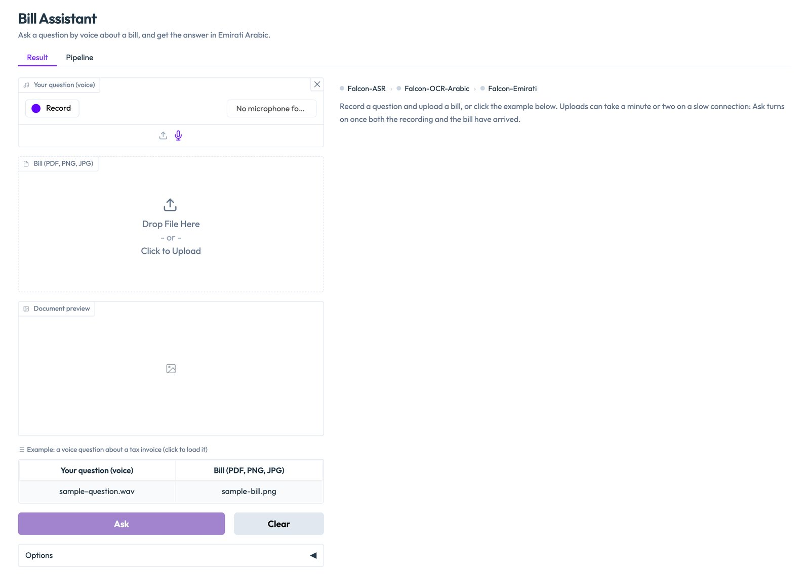
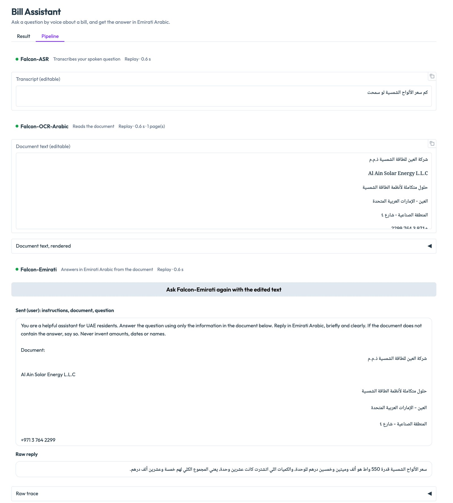

<style>
.screenshot {
  display: block;
  box-sizing: border-box;
  width: 100%;
  max-width: 100%;
  height: auto;
  object-fit: contain;
  margin: 1.5em auto;
  border-radius: 8px;
  box-shadow: 0 4px 6px rgba(0, 0, 0, 0.1);
}
.caption {
  text-align: center;
  font-size: 0.85em;
  opacity: 0.75;
  margin: -0.8em auto 1.5em;
  max-width: 100%;
}
.post-content table:not(.highlighttable, .highlight table, .gist .highlight) {
  display: table;
  width: 100% !important;
  border-collapse: separate;
  border-spacing: 0;
  border: 1px solid rgba(0, 0, 0, 0.18);
  border-radius: 8px;
  overflow: hidden;
  font-size: 0.9em;
}
.post-content table:not(.highlighttable, .highlight table, .gist .highlight) th {
  font-size: 1em;
  font-weight: 600;
  text-align: right;
  background: var(--code-bg);
}
.post-content table:not(.highlighttable, .highlight table, .gist .highlight) th,
.post-content table:not(.highlighttable, .highlight table, .gist .highlight) td {
  padding: 10px 14px;
  text-align: right;
  vertical-align: top;
  border-bottom: 1px solid rgba(0, 0, 0, 0.18);
  border-left: 1px solid rgba(0, 0, 0, 0.18);
}
.post-content table:not(.highlighttable, .highlight table, .gist .highlight) th:last-child,
.post-content table:not(.highlighttable, .highlight table, .gist .highlight) td:last-child {
  border-left: 0;
}
.post-content table:not(.highlighttable, .highlight table, .gist .highlight) tbody tr:last-child td {
  border-bottom: 0;
}
.post-content table:not(.highlighttable, .highlight table, .gist .highlight) tbody tr:nth-child(even) td {
  background: rgba(0, 0, 0, 0.02);
}
@media (max-width: 600px) {
  .post-content table:not(.highlighttable, .highlight table, .gist .highlight) {
    display: block;
    overflow-x: auto;
  }
}
.excerpt {
  font-size: 0.85em;
  opacity: 0.85;
  margin: 0.2em 0 0.4em;
}
.excerpt code {
  font-size: 0.95em;
}
/* Keep code left-to-right inside the RTL article */
.post-content [dir="rtl"] pre,
.post-content [dir="rtl"] pre code {
  direction: ltr;
  text-align: left;
}
.post-content [dir="rtl"] :not(pre) > code {
  direction: ltr;
  unicode-bidi: isolate;
}
.rtl-block pre,
.rtl-block code,
.rtl-block .line {
  unicode-bidi: plaintext;
  text-align: start;
}
.rtl-block .line {
  display: block;
}
</style>

<div dir="rtl">

## مقدمة

تحتوي الفاتورة على عدة أرقام يمكن أن يجيب كل منها عن صيغة مختلفة للسؤال نفسه. فسؤال "كم سعر الألواح الشمسية؟" قد يعني سعر اللوح الواحد أو تكلفة الألواح العشرين كلها. ولكي يكون المساعد مفيدًا، عليه أن يجد السطر الصحيح، وأن يفصل بين هذين المبلغين، وأن يقدّم إجابة يستطيع القارئ التحقق منها.

يتتبّع هذا الدرس تطبيق Gradio صغيرًا يستقبل سؤالًا منطوقًا وصورة أو ملف PDF لفاتورة. يحوّل Falcon-ASR السؤال إلى نص، ويقرأ Falcon-OCR-Arabic المستند، ثم يجيب Falcon-Emirati باللهجة الإماراتية بالاعتماد على النصّين. ويعرض التطبيق كل نتيجة وسيطة، لأن الإجابة السلسة ليست دليلًا على صحة الأرقام.

## الفاتورة النموذجية

العيّنة هي فاتورة ضريبية من شركة لتركيب الألواح الشمسية في العين. تتضمن عشرين لوحًا بقدرة 550 واط، وعاكسَين (Inverter)، وهيكل تثبيت، وكابلات، وأعمال التركيب، تليها ضريبة القيمة المضافة. والسؤال المنطوق هو *"كم سعر الألواح الشمسية لو سمحت؟"*. ويذكر السطر المعني 1,250 درهمًا للوح الواحد و25,000 درهم للألواح العشرين.

هذه مهمة بحث بسيطة، لكن هناك موضعين قد يحدث فيهما الخطأ قبل كتابة الإجابة: قد يغيّر التعرّف على الكلام السؤال، وقد يغيّر التعرّف الضوئي على النصوص (OCR) رقمًا أو ينسبه إلى السطر الخطأ. يعرض تبويب **Pipeline** النصّين كليهما، بينما يجمع تبويب **Result** المدخلات وحالة النماذج والإجابة في مكان واحد.





<p class="caption">قبل التشغيل. انقر على المثال لتحميل السؤال المسجّل والفاتورة، ثم اضغط <strong>Ask</strong>.</p>


<p class="caption">يعرض المثال المسجّل الفاتورة والسؤال والإجابة معًا.</p>

يمكنك تجربة هذا المثال دون مفاتيح أو وحدة معالجة رسومات (GPU)، فهو يعرض نتائج عملية تشغيل محفوظة. أما سؤالك وفاتورتك الخاصّان فيستخدمان نقاط النهاية المباشرة للنماذج، والتي تتطلب صلاحية الوصول الموضّحة أدناه.

## كيف تتكامل الخطوات الثلاث

يمكن معالجة المدخلَين في الوقت نفسه:

1. **[Falcon-ASR](https://huggingface.co/blog/tiiuae/falcon-asr)** (1.6B) يحوّل الصوت إلى نص مكتوب. تغطي أوزانه اللهجة الإماراتية والعربية الفصحى ولهجات خليجية أخرى والإنجليزية، لذلك لا يطلب منك التطبيق اختيار اللغة.
2. **[Falcon-OCR-Arabic](https://huggingface.co/blog/tiiuae/falcon-ocr-arabic)** (270M) يستخرج النص من كل صفحة في الفاتورة، بما في ذلك جداول HTML. وإذا لم يتوفر عنوانه (URL) ومفتاحه، يستخدم التطبيق **[Falcon-OCR](https://huggingface.co/tiiuae/Falcon-OCR)** (270M) عبر بوابة الرؤية العامة.
3. **[Falcon-Emirati](https://huggingface.co/blog/tiiuae/falcon-emirati)** (7B) يستقبل التفريغ النصي للسؤال ونص الفاتورة المستخرج، ويكتب إجابة باللهجة الإماراتية دون أن يتلقى الصوت أو الصورة.


<p class="caption">يعمل التعرّف على الكلام والتعرّف الضوئي معًا، بينما ينتظر Falcon-Emirati النصّين كليهما.</p>

ما يُسلَّم إلى Falcon-Emirati هو نص عادي، وهذا يجعل الحد الفاصل بين الخطوات سهل الفحص: فإذا كان سعر اللوح خاطئًا في نص الـ OCR، فالمشكلة حدثت قبل توليد الإجابة. ويمكنك تصحيح أيٍّ من النصّين بعد الإجابة الأولى وإعادة تشغيل Falcon-Emirati وحده.

## تشغيل المثال

يستضيف الـ [Space](https://huggingface.co/spaces/tiiuae/bill-assistant) التطبيق، ويحتوي تبويب **Files** فيه على الشيفرة. ولتشغيل التطبيق نفسه محليًا، انسخ الـ Space واستخدم Python 3.12 مع [uv](https://docs.astral.sh/uv/):

```bash
git clone https://huggingface.co/spaces/tiiuae/bill-assistant
cd bill-assistant
uv sync
uv run python app.py
```

إذا كان الـ Space يخزّن الفاتورة النموذجية باستخدام Git LFS/Xet، فثبّت [git-lfs](https://git-lfs.com) قبل النسخ، لأن ملف المؤشر (pointer file) الذي يحلّ محل `assets/sample-bill.png` لن يطابق المثال المسجّل. ولرفع ملفات صوتية بصيغ غير WAV، مثل mp3 أو m4a، ثبّت [ffmpeg](https://ffmpeg.org)؛ إذ يحصل عليه الـ Space من `packages.txt`.

افتح `http://127.0.0.1:7860`، وانقر على المثال أسفل المدخلات لتحميل `assets/sample-question.wav` و`assets/sample-bill.png`، ثم اضغط **Ask**. يعيد التطبيق عرض التفريغ النصي ونص الـ OCR والإجابة من `assets/sample-bill.recording.json` دون أي استدعاء للنماذج. وتتطلب إعادة العرض أن يطابق الملفان العيّنتين بايتًا ببايت؛ أما السؤال أو الفاتورة المختلفان فيسلكان المسار المباشر.

في هذا المسار المباشر، يذهب التسجيل إلى Falcon-ASR، وتذهب الفاتورة إلى Falcon-OCR-Arabic أو إلى بوابة الرؤية العامة، ويستقبل Falcon-Emirati مخرجاتهما النصية. استخدم مستندات تجريبية عند تجربة نقاط النهاية.

### الوصول إلى النماذج

لا تحتاج بوابة Falcon-OCR العامة إلى مفتاح. أما Falcon-ASR وFalcon-OCR-Arabic وFalcon-Emirati فيحتاج كل منها إلى مفتاح من نوع Bearer، كما يحتاج الأخيران أيضًا إلى عنوان نقطة نهاية:

| النموذج | المتغيرات | في غيابها |
| --- | --- | --- |
| Falcon-ASR | `FALCON_ASR_API_KEY` | لا يمكن تحويل أسئلتك إلى نص، لكن المثال يظل قابلًا لإعادة العرض |
| Falcon-OCR-Arabic | `FALCON_ARABIC_OCR_URL`، `FALCON_ARABIC_OCR_API_KEY` | يقرأ Falcon-OCR على البوابة الفاتورة |
| Falcon-Emirati | `FALCON_LLM_URL`، `FALCON_LLM_API_KEY` | تعرض الإجابة نص الفاتورة، مع شارة `Not configured` |

اطلب الوصول عبر [نموذج التواصل الخاص بـ TII](https://www.tii.ae/contact-us)، مع ذكر اسم النموذج. ويمكنك تجربة [العرض التوضيحي لـ Falcon-ASR](https://huggingface.co/spaces/tiiuae/falcon-asr-demo)، و[منصة تجربة Falcon-OCR-Arabic](https://ocr.arabic.aidrc.tii.ae/)، و[Falcon Chat](https://chat.falconllm.tii.ae/?model=Falcon-Emirati-7B) دون مفاتيح الـ API هذه. كما يُعد [خادم Falcon على Discord](https://discord.gg/Cbek57PrZE) مكانًا آخر للسؤال عن الوصول.

للتشغيل المباشر محليًا، ضع القيم في ملف `.env` بجانب `app.py` (وهو مستثنى في gitignore ويُحمَّل عند بدء التشغيل)، أو صدّرها في الطرفية (shell):

```bash
FALCON_ASR_API_KEY=<key>
FALCON_ARABIC_OCR_URL=https://<host>/v1/ocr
FALCON_ARABIC_OCR_API_KEY=<key>
FALCON_LLM_URL=https://<host>/v1
FALCON_LLM_API_KEY=<key>
```

ويوفّر التطبيق قيمًا افتراضية لبقية الإعدادات:

| الاسم | القيمة الافتراضية | الوظيفة |
| --- | --- | --- |
| `FALCON_ASR_URL`، `FALCON_OCR_URL` | نقاط نهاية TII | عنوانا Falcon-ASR وبوابة الرؤية |
| `FALCON_LLM_MODEL` | `falcon-h1-7b-emirati` | معرّف نموذج Falcon-Emirati (Falcon-Emirati-7B) |
| `OCR_TASK` | `ocr_plain` | `ocr_plain` أو `ocr_layout`، لـ Falcon-OCR فقط |
| `APP_PASSWORD` | غير مضبوط | يفعّل تسجيل الدخول باسم المستخدم `demo` |
| `MAX_DOC_MB`، `MAX_AUDIO_SECONDS`، `QUEUE_CONCURRENCY` | `10`، `60`، `4` | حجم الفاتورة، وطول السؤال، وعدد عمليات التشغيل المتزامنة |

أعد تشغيل التطبيق بعد تغيير المتغيرات، وسيعرض تبويب **Result** حينها النماذج المهيّأة للاستدعاءات المباشرة.

### الملفات

```text
bill-assistant/
  app.py                 Gradio UI: the Result and Pipeline tabs
  pipeline.py            runs the three steps and records each one's status and output
  config.py              environment variables and defaults
  record_example.py      records the example's run
  ui_helpers.py          theme, CSS and HTML rendering
  alerts.py              optional Slack alerts for the endpoints
  services/
    asr.py               Falcon-ASR
    ocr.py               Falcon-OCR-Arabic, with Falcon-OCR on the gateway
    vision.py            client for the public vision gateway
    llm.py               Falcon-Emirati
    fixtures.py          replay of the example
  assets/
    sample-question.wav
    sample-bill.png
    sample-bill.recording.json
```

## تحويل السؤال إلى نص باستخدام Falcon-ASR

أول ما يهمّ خط المعالجة هو: هل سمع نظام التعرّف على الكلام البند الصحيح؟ يرفع التطبيق الصوت إلى `/api/transcription/transcribe` كبيانات multipart. تؤدي الاستجابة `429` أو `409` إلى الانتظار بحسب `Retry-After`، بينما يتوقف التطبيق لفترة قصيرة عند تلقي استجابة من نوع `5xx`. ويُرسَل الطلب ثلاث مرات كحد أقصى:

<p class="excerpt"><strong>مقتطف</strong> من <a href="https://huggingface.co/spaces/tiiuae/bill-assistant/blob/main/services/asr.py"><code>services/asr.py</code></a>: <code>_transcribe_live</code></p>

```python
headers = {
    "Authorization": f"Bearer {cfg.api_key}",
    "Idempotency-Key": str(uuid.uuid4()),
}

response: requests.Response | None = None
for delay in (1, 2, None):
    with path.open("rb") as audio:
        response = requests.post(
            url,
            headers=headers,
            files={"audio_file": (path.name, audio, mime)},
            data={"audio_source": "file_upload"},
            timeout=(10, 330),
        )
    if response.status_code in (429, 409) and delay is not None:
        time.sleep(_retry_after_seconds(response.headers.get("Retry-After")))
        continue
    if response.status_code >= 500 and delay is not None:
        time.sleep(delay)
        continue
    break
```

تعيد المحاولات استخدام مفتاح `Idempotency-Key` نفسه، مما يتيح لنقطة النهاية التعرّف على إعادة المحاولة، وإن كان منع التكرار يعتمد على احترام نقطة النهاية لهذه الترويسة. وتحتوي الاستجابة الناجحة على `status` بالقيمة `"ok"` وعلى الكلمات في `transcription`. وبالنسبة للمقطع النموذجي ومدته خمس ثوانٍ، فإن النص المحفوظ هو:

<div class="rtl-block">

```text
كم سعر الألواح الشمسية لو سمحت
```
</div>

## قراءة الفاتورة باستخدام Falcon-OCR-Arabic

للتعرّف الضوئي على النصوص مهمة مختلفة: الحفاظ على العلاقة بين البند وكميته وسعر الوحدة والإجمالي. يقبل Falcon-OCR-Arabic الصور، لذلك يرسل التطبيق الصورة كما هي. أما ملف PDF، فتحوّل مكتبة PyMuPDF ما يصل إلى ثماني صفحات منه إلى صور JPEG بدقة 150 DPI، وتحصل كل صفحة على طلب multipart خاص بها:

<p class="excerpt"><strong>مقتطف</strong> من <a href="https://huggingface.co/spaces/tiiuae/bill-assistant/blob/main/services/ocr.py"><code>services/ocr.py</code></a>: <code>_arabic_image</code> (مختصر)</p>

```python
with image_path.open("rb") as handle:
    response = httpx.post(
        config.ARABIC_OCR_URL,
        headers={"Authorization": f"Bearer {config.ARABIC_OCR_API_KEY}"},
        files={"file": (image_path.name, handle, mime)},
        timeout=config.ARABIC_OCR_TIMEOUT_S,
    )
    # ...
    response.raise_for_status()
    payload = response.json()
```

عند ضبط `FALCON_ARABIC_OCR_URL` و`FALCON_ARABIC_OCR_API_KEY`، يبدأ خيار **Enhance Arabic** ضمن **Options** مفعّلًا. وفي غيابهما يكون الخيار معطّلًا، ويقرأ Falcon-OCR على البوابة العامة الصفحات. كما أن استجابة تجاوز الحصة من Falcon-OCR-Arabic ترسل المستند كاملًا عبر Falcon-OCR. وفي الفواتير متعددة الصفحات، تُبقي العلامات `--- page N ---` الصفحات المستخرجة منفصلة في النص المُمرَّر إلى Falcon-Emirati.

في عملية التشغيل المسجّلة، أعاد Falcon-OCR-Arabic ترويسة الفاتورة وبيانات العميل والملاحظات كنص، وجدولَي البنود والإجماليات بصيغة HTML. ويعرض تبويب **Pipeline** جدول البنود التالي:

| # | البند | الكمية | سعر الوحدة (درهم) | الإجمالي (درهم) |
| --- | --- | --- | --- | --- |
| 1 | ألواح شمسية قدرة 550 واط | 20 | 1,250 | 25,000 ✓ |
| 2 | عاكس (Inverter) 10 كيلوواط | 2 | 6,500 | 13,000 |
| 3 | هيكل تثبيت الألواح (ألومنيوم) | 1 | 3,200 | 3,200 - |
| 4 | كابلات وملحقات التركيب | 1 | 2,150 | 2,150 |
| 5 | أعمال التركيب والتشغيل | 1 | 5,000 | 5,000 ✓ |

تظهر العلامات المكتوبة بخط اليد بجانب بعض الإجماليات على شكل `✓`. ويحتوي الجدول الآخر على مجموع فرعي قدره 48,350 درهمًا، وضريبة قيمة مضافة بنسبة 5% قدرها 2,417.50 درهمًا، وإجمالي نهائي قدره 50,767.50 درهمًا. والسؤال عن الألواح يتطلب السطر الأول، وليس إجمالي الفاتورة.

## سؤال Falcon-Emirati

بمجرد توفّر النصّين، يحتاج Falcon-Emirati إلى ربط السؤال بالسطر الصحيح. يضع التطبيق تعليماته ونص الفاتورة المستخرج والتفريغ النصي للسؤال في رسالة مستخدم واحدة. وبما أن نقطة النهاية تطبّق موجّه النظام (system prompt) الخاص بها، يرسل التطبيق تعليماته ضمن رسالة المستخدم هذه:

<p class="excerpt"><strong>مقتطف</strong> من <a href="https://huggingface.co/spaces/tiiuae/bill-assistant/blob/main/services/llm.py"><code>services/llm.py</code></a>: <code>INSTRUCTIONS</code> و<code>build_message</code></p>

```python
INSTRUCTIONS = (
    "You are a helpful assistant for UAE residents. Answer the question using only "
    "the information in the document below. Reply in Emirati Arabic, briefly and "
    "clearly. If the document does not contain the answer, say so. Never invent "
    "amounts, dates or names."
)


def build_message(question: str, document_text: str) -> str:
    return (
        f"{INSTRUCTIONS}\n\n"
        f"Document:\n{document_text.strip()}\n\n"
        f"Question:\n{question.strip()}"
    )
```

تستخدم نقطة النهاية بروتوكول chat-completions الخاص بـ OpenAI. ويستدعيها التطبيق عبر عميل `openai` بمعرّف النموذج `falcon-h1-7b-emirati`، ويستخدم المحتوى المُعاد بوصفه الإجابة.

الإجابة المسجّلة على سؤال المثال هي:

<blockquote dir="rtl" lang="ar">
<p>سعر الألواح الشمسية قدرة 550 واط هو ألف وميتين وخمسين درهم للوحدة، والكميات اللي اتشترت كانت عشرين وحدة، يعني المجموع الكلي لهم خمسة وعشرين ألف درهم.</p>
</blockquote>

أي أن سعر اللوح الواحد بقدرة 550 واط هو 1,250 درهمًا، وأن الألواح العشرين تكلّف معًا 25,000 درهم. وهذا يطابق السطر الأول: 20 × 1,250 = 25,000. كما تذكر الإجابة الرقمين بالكلمات، وهو ما يناسب سؤالًا منطوقًا.

إذا غاب `FALCON_LLM_URL` أو `FALCON_LLM_API_KEY`، فلا تستدعي هذه الخطوة أي نموذج، بل تعرض نص الفاتورة المستخرج مع تنبيه `Not configured` بدلًا من اختلاق إجابة.

## إبقاء الخطوات قابلة للفحص

لا يعتمد التعرّف على الكلام والتعرّف الضوئي أحدهما على الآخر، لذلك تبدأهما الدالة `run_pipeline` معًا، ولا يبدأ Falcon-Emirati إلا بعد نجاح كليهما. ويُنتج خط المعالجة سجلّ تتبّع (trace) جديدًا بعد كل تغيّر في الحالة، وتعرض الواجهة الحالة والمخرجات انطلاقًا من هذا السجل:

<p class="excerpt"><strong>مقتطف</strong> من <a href="https://huggingface.co/spaces/tiiuae/bill-assistant/blob/main/pipeline.py"><code>pipeline.py</code></a>: <code>run_pipeline</code> (مختصر)</p>

```python
trace = new_trace(enhance_arabic)
replay = fixtures.replays(doc_path, audio_path)
# ...
with ThreadPoolExecutor(2) as pool:
    futures = {
        pool.submit(asr.transcribe, audio_path, replay): "asr",
        pool.submit(ocr.run_ocr, doc_path, enhance_arabic, replay): "ocr",
    }
    for future in as_completed(futures):
        _record(trace, futures[future], future.result)
        yield copy.deepcopy(trace)

if trace["asr"]["status"] == "done" and trace["ocr"]["status"] == "done":
    yield from _run_llm(
        trace, trace["asr"]["output"]["text"], trace["ocr"]["output"]["text"], replay
    )
else:
    trace["llm"]["status"] = "skipped"
    yield copy.deepcopy(trace)
```

يحتوي كل مُدخل في سجل التتبّع على الحالة والنموذج والتوقيت والخطأ والمخرجات، ولا يحتوي على أي مفتاح API. وإذا فشل التعرّف على الكلام أو التعرّف الضوئي، تُعلَّم خطوة Falcon-Emirati بأنها `skipped`، فلا تجيب انطلاقًا من المُدخل الوحيد الذي صادف أنه نجح.

يتبع المثال المسار نفسه باستخدام مخرجات محفوظة. فقد أجرى `record_example.py` استدعاءات مباشرة على السؤال والفاتورة النموذجيين، ثم خزّن التفريغ النصي ونص الفاتورة والرد. وتتحقق إعادة العرض من بايتات المدخلَين، لذا لا يمكن إعادة استخدام الإجابة المسجّلة لفاتورة أو سؤال مختلف. وبعد تغيير عيّنة أو الموجّه أو نموذج ما، حدّث التسجيل مع تهيئة نقاط النهاية:

```bash
uv run python record_example.py
```

## التحقق من الإجابة في التطبيق

يضع تبويب **Result** السؤال الصوتي ومعاينة الفاتورة والمثال وزرَّي **Ask** و**Clear** على اليسار، بينما تظهر حالة النماذج وتوقيتها بجانب الإجابة باللهجة الإماراتية على اليمين، بما في ذلك ما إذا كانت كل خطوة قد استدعت النموذج مباشرة أو أعادت عرض نتيجة مسجّلة.

أما تبويب **Pipeline** فهو المكان المناسب لتقصّي إجابة مشكوك فيها. تحقّق من التفريغ النصي للسؤال أولًا، ثم من السطر والمبلغ المستخرجَين. ويمكنك تعديل أيٍّ من النصّين والضغط على **Ask Falcon-Emirati again with the edited text**، وهذا يشغّل الخطوة الأخيرة فقط. كما يعرض التبويب الرسالة الدقيقة المُرسلة إلى Falcon-Emirati ورده الخام.


<p class="caption">يعرض تبويب Pipeline التفريغ النصي ونص الـ OCR والرسالة والرد في عملية التشغيل المسجّلة.</p>

جرّب الـ [Space](https://huggingface.co/spaces/tiiuae/bill-assistant) بفاتورة تجريبية وسؤالك الخاص، أو انسخه لتشغيل المثال محليًا. تُظهر الإجابة المسجّلة أن هذا السؤال تحديدًا وصل إلى السطر الصحيح في الفاتورة. أما مع فاتورة جديدة، فيبقى التحقق المفيد هو نفسه: قارن التفريغ النصي للسؤال والمبلغ المستخرج والإجابة بما هو مطبوع على الصفحة.

## المراجع

- [Bill Assistant Space](https://huggingface.co/spaces/tiiuae/bill-assistant): التطبيق وشيفرته.
- [Falcon-ASR](https://huggingface.co/blog/tiiuae/falcon-asr): تدوينة الإعلان، و[Space العرض التوضيحي لـ Falcon-ASR](https://huggingface.co/spaces/tiiuae/falcon-asr-demo).
- [Falcon-OCR-Arabic](https://huggingface.co/blog/tiiuae/falcon-ocr-arabic): تدوينة الإعلان. وهو القارئ الافتراضي عند تهيئة نقطة النهاية الخاصة به.
- [Falcon-OCR](https://huggingface.co/tiiuae/Falcon-OCR): بطاقة النموذج وأوزانه. وهو القارئ المتاح على بوابة الرؤية العامة.
- [Falcon-Emirati](https://huggingface.co/blog/tiiuae/falcon-emirati) و[صفحة النموذج](https://falconllm.tii.ae/falcon-emirati.html).
- [إعلان TII: Falcon-Emirati وFalcon-ASR وFalcon-OCR-Arabic](https://www.wam.ae/a/c2mg25j)
- [نموذج التواصل الخاص بـ TII](https://www.tii.ae/contact-us)، لطلب الوصول إلى النماذج.
- [توثيق Gradio](https://www.gradio.app/docs)، و[uv](https://docs.astral.sh/uv/)، و[PyMuPDF](https://pymupdf.readthedocs.io/).

</div>
