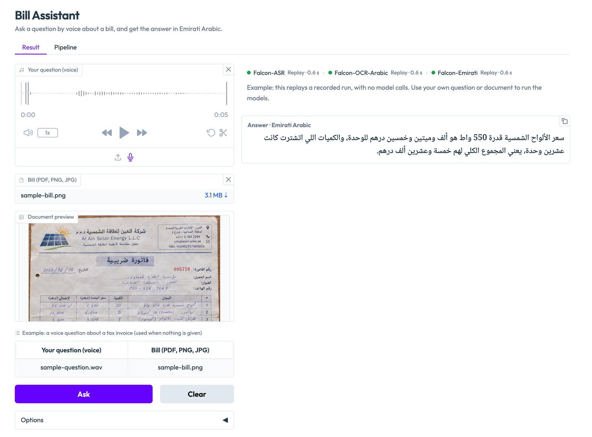

<style>
.screenshot {
  display: block;
  box-sizing: border-box;
  width: 100%;
  max-width: 100%;
  height: auto;
  object-fit: contain;
  margin: 1.5em auto;
  border-radius: 8px;
  box-shadow: 0 4px 6px rgba(0, 0, 0, 0.1);
}
.caption {
  text-align: center;
  font-size: 0.85em;
  opacity: 0.75;
  margin: -0.8em auto 1.5em;
  max-width: 100%;
}
.post-content table:not(.highlighttable, .highlight table, .gist .highlight) {
  display: table;
  width: 100% !important;
  border-collapse: separate;
  border-spacing: 0;
  border: 1px solid rgba(0, 0, 0, 0.18);
  border-radius: 8px;
  overflow: hidden;
  font-size: 0.9em;
}
.post-content table:not(.highlighttable, .highlight table, .gist .highlight) th {
  font-size: 1em;
  font-weight: 600;
  text-align: right;
  background: var(--code-bg);
}
.post-content table:not(.highlighttable, .highlight table, .gist .highlight) th,
.post-content table:not(.highlighttable, .highlight table, .gist .highlight) td {
  padding: 10px 14px;
  text-align: right;
  vertical-align: top;
  border-bottom: 1px solid rgba(0, 0, 0, 0.18);
  border-left: 1px solid rgba(0, 0, 0, 0.18);
}
.post-content table:not(.highlighttable, .highlight table, .gist .highlight) th:last-child,
.post-content table:not(.highlighttable, .highlight table, .gist .highlight) td:last-child {
  border-left: 0;
}
.post-content table:not(.highlighttable, .highlight table, .gist .highlight) tbody tr:last-child td {
  border-bottom: 0;
}
.post-content table:not(.highlighttable, .highlight table, .gist .highlight) tbody tr:nth-child(even) td {
  background: rgba(0, 0, 0, 0.02);
}
@media (max-width: 600px) {
  .post-content table:not(.highlighttable, .highlight table, .gist .highlight) {
    display: block;
    overflow-x: auto;
  }
}
.excerpt {
  font-size: 0.85em;
  opacity: 0.85;
  margin: 0.2em 0 0.4em;
}
.excerpt code {
  font-size: 0.95em;
}
/* Keep code left-to-right inside the RTL article */
.post-content [dir="rtl"] pre,
.post-content [dir="rtl"] pre code {
  direction: ltr;
  text-align: left;
}
.post-content [dir="rtl"] :not(pre) > code {
  direction: ltr;
  unicode-bidi: isolate;
}
.rtl-block pre,
.rtl-block code,
.rtl-block .line {
  unicode-bidi: plaintext;
  text-align: start;
}
.rtl-block .line {
  display: block;
}
</style>

<div dir="rtl">

## مقدمة

قد تحتوي الفاتورة على أكثر من رقم مرتبط بالبند نفسه. فعندما يسأل أحدهم: «كم سعر الألواح الشمسية؟»، هل يقصد سعر اللوح الواحد أم سعر جميع الألواح العشرين؟ على المساعد أن يحدد البند المطلوب، ويميّز بين سعر الوحدة والسعر الإجمالي، ثم يقدم إجابة واضحة يمكن التحقق منها.

نتعرّف في هذا الدليل إلى تطبيق بسيط مبني باستخدام Gradio. يتيح التطبيق طرح سؤال بالصوت وإرفاق صورة فاتورة أو ملف PDF. يحوّل Falcon-ASR السؤال المنطوق إلى نص، ويستخرج Falcon-OCR-Arabic المعلومات من الفاتورة، ثم يستخدم Falcon-Emirati النصين للإجابة باللهجة الإماراتية. ويعرض التطبيق نتائج كل مرحلة حتى تتمكن من مراجعة الأرقام، بدلًا من الاعتماد على إجابة تبدو صحيحة فقط.

## الفاتورة النموذجية

نستخدم في هذا المثال فاتورة ضريبية صادرة عن شركة لتركيب أنظمة الطاقة الشمسية في مدينة العين. تتضمن الفاتورة 20 لوحًا شمسيًا بقدرة 550 واط للوح، وعاكسين كهربائيين (Inverter)، وهيكل تثبيت وكابلات وتكاليف التركيب، إضافة إلى ضريبة القيمة المضافة. السؤال المسجّل هو **«كم سعر الألواح الشمسية لو سمحت؟»**. ويظهر في البند المعني أن سعر اللوح الواحد 1,250 درهمًا، وأن سعر الألواح العشرين 25,000 درهم.

قد يبدو العثور على السعر أمرًا سهلًا، لكن الخطأ قد يحدث في مرحلتين: فقد يتعرف نموذج تحويل الكلام إلى نص على السؤال بصورة غير صحيحة، أو يقرأ نموذج OCR رقمًا خطأ أو يربطه ببند آخر. لذلك يعرض تبويب **Pipeline** النص الناتج من الصوت والنص المستخرج من الفاتورة، بينما يجمع تبويب **Result** المدخلات وحالة النماذج والإجابة النهائية.





<p class="caption">قبل التشغيل: اختر المثال لتحميل التسجيل الصوتي والفاتورة، ثم اضغط <strong>Ask</strong>.</p>


<p class="caption">يعرض المثال المحفوظ الفاتورة والسؤال الصوتي والإجابة في شاشة واحدة.</p>

يمكنك تجربة المثال الجاهز دون مفاتيح API أو بطاقة GPU؛ إذ يعرض التطبيق نتائج تشغيل محفوظة مسبقًا. أما عند استخدام تسجيل صوتي أو فاتورة من اختيارك، فسيستدعي التطبيق النماذج مباشرة، وهو ما يتطلب إعداد صلاحيات الوصول الموضحة لاحقًا.

## كيف تتكامل الخطوات الثلاث

يمكن معالجة المدخلَين في الوقت نفسه:

1. **[Falcon-ASR](https://huggingface.co/blog/tiiuae/falcon-asr)** (1.6B) يحوّل الصوت إلى نص مكتوب. تغطي أوزانه اللهجة الإماراتية والعربية الفصحى ولهجات خليجية أخرى والإنجليزية، لذلك لا يطلب منك التطبيق اختيار اللغة.
2. **[Falcon-OCR-Arabic](https://huggingface.co/blog/tiiuae/falcon-ocr-arabic)** (270M) يستخرج النص من كل صفحة في الفاتورة، بما في ذلك جداول HTML. وإذا لم يتوفر عنوانه (URL) ومفتاحه، يستخدم التطبيق **[Falcon-OCR](https://huggingface.co/tiiuae/Falcon-OCR)** (270M) عبر بوابة الرؤية العامة.
3. **[Falcon-Emirati](https://huggingface.co/blog/tiiuae/falcon-emirati)** (7B) يستقبل التفريغ النصي للسؤال ونص الفاتورة المستخرج، ويكتب إجابة باللهجة الإماراتية دون أن يتلقى الصوت أو الصورة.


<p class="caption">تُعالَج الفاتورة والسؤال الصوتي بالتوازي، ثم يبدأ Falcon-Emirati عمله بعد استخراج النصين.</p>

لا يتلقى Falcon-Emirati الصوت أو الصورة، بل النصين الناتجين من المرحلتين السابقتين. وهذا يجعل تتبع الأخطاء أسهل: فإذا ظهر سعر خاطئ في النص المستخرج بواسطة OCR، نعرف أن الخطأ حدث قبل توليد الإجابة. وبعد ظهور الإجابة الأولى، يمكنك تعديل نص السؤال أو الفاتورة وإعادة تشغيل Falcon-Emirati فقط.

## تشغيل المثال

يمكنك فتح التطبيق عبر [Hugging Face Space](https://huggingface.co/spaces/tiiuae/bill-assistant)، والاطلاع على شيفرته من تبويب **Files**. وإذا أردت تشغيله على جهازك، فانسخ المستودع واستخدم Python 3.12 مع [uv](https://docs.astral.sh/uv/):

```bash
git clone https://huggingface.co/spaces/tiiuae/bill-assistant
cd bill-assistant
uv sync
uv run python app.py
```

إذا كانت ملفات المثال محفوظة باستخدام Git LFS/Xet، فثبّت [git-lfs](https://git-lfs.com) قبل نسخ المستودع. وإلا فقد تحصل على ملف يشير إلى الصورة بدلًا من الصورة الفعلية `assets/sample-bill.png`، ولن يعمل المثال المحفوظ كما هو متوقع. ولدعم ملفات الصوت مثل mp3 وm4a، ثبّت [ffmpeg](https://ffmpeg.org). أما في الـ Space، فيُثبَّت تلقائيًا عبر `packages.txt`.

افتح \`http://127.0.0.1:7860\`، وانقر على المثال أسفل المدخلات لتحميل \`assets/sample-question.wav\` و\`assets/sample-bill.png\`، ثم اضغط **Ask**. يعيد التطبيق عرض التفريغ النصي ونص الـ OCR والإجابة من \`assets/sample-bill.recording.json\` دون أي استدعاء للنماذج. وتتطلب إعادة العرض أن يتطابق الملفان مع العيّنتين تمامًا، بايتًا ببايت؛ أما السؤال أو الفاتورة المختلفان فيسلكان المسار المباشر.

عند التشغيل المباشر، يُرسل التسجيل الصوتي إلى Falcon-ASR، وتُرسل الفاتورة إلى Falcon-OCR-Arabic أو بوابة معالجة الصور العامة. وبعد استخراج النصين، يُرسلان إلى Falcon-Emirati لتوليد الإجابة. يُفضّل استخدام مستندات تجريبية عند اختبار واجهات API.

### الوصول إلى النماذج

يمكن استخدام بوابة Falcon-OCR العامة دون مفتاح API. أما Falcon-ASR وFalcon-OCR-Arabic وFalcon-Emirati، فيحتاج كل منها إلى مفتاح مصادقة من نوع Bearer. ويحتاج النموذجان الأخيران أيضًا إلى عنوان واجهة API:

| النموذج | المتغيرات | في غيابها |
| --- | --- | --- |
| Falcon-ASR | `FALCON_ASR_API_KEY` | لا يمكن تحويل أسئلتك إلى نص، لكن المثال يظل قابلًا لإعادة العرض |
| Falcon-OCR-Arabic | `FALCON_ARABIC_OCR_URL`، `FALCON_ARABIC_OCR_API_KEY` | يقرأ Falcon-OCR على البوابة الفاتورة |
| Falcon-Emirati | `FALCON_LLM_URL`، `FALCON_LLM_API_KEY` | تعرض الإجابة نص الفاتورة، مع شارة `Not configured` |

لطلب صلاحية استخدام النماذج، تواصل مع TII عبر [نموذج التواصل](https://www.tii.ae/contact-us)، مع تحديد اسم النموذج المطلوب. ويمكنك أيضًا تجربة [Falcon-ASR](https://huggingface.co/spaces/tiiuae/falcon-asr-demo)، و[واجهة Falcon-OCR-Arabic](https://ocr.arabic.aidrc.tii.ae/)، و[Falcon Chat](https://chat.falconllm.tii.ae/?model=Falcon-Emirati-7B) دون هذه المفاتيح. وللاستفسارات، يمكنك زيارة [مجتمع Falcon على Discord](https://discord.gg/Cbek57PrZE).

لتشغيل النماذج مباشرة على جهازك، أضف القيم إلى ملف `.env` بجانب `app.py`، أو عرّفها في الطرفية. يقرأ التطبيق ملف `.env` عند بدء التشغيل، وهو مستثنى من تتبع Git:

```bash
FALCON_ASR_API_KEY=<key>
FALCON_ARABIC_OCR_URL=https://<host>/v1/ocr
FALCON_ARABIC_OCR_API_KEY=<key>
FALCON_LLM_URL=https://<host>/v1
FALCON_LLM_API_KEY=<key>
```

ويوفّر التطبيق قيمًا افتراضية لبقية الإعدادات:

| الاسم | القيمة الافتراضية | الوظيفة |
| --- | --- | --- |
| `FALCON_ASR_URL`، `FALCON_OCR_URL` | نقاط نهاية TII | عنوانا Falcon-ASR وبوابة الرؤية |
| `FALCON_LLM_MODEL` | `falcon-h1-7b-emirati` | معرّف نموذج Falcon-Emirati (Falcon-Emirati-7B) |
| `OCR_TASK` | `ocr_plain` | `ocr_plain` أو `ocr_layout`، لـ Falcon-OCR فقط |
| `APP_PASSWORD` | غير مضبوط | يفعّل تسجيل الدخول باسم المستخدم `demo` |
| `MAX_DOC_MB`، `MAX_AUDIO_SECONDS`، `QUEUE_CONCURRENCY` | `10`، `60`، `4` | حجم الفاتورة، وطول السؤال، وعدد عمليات التشغيل المتزامنة |

بعد تعديل متغيرات البيئة، أعد تشغيل التطبيق. وسيعرض تبويب **Result** النماذج الجاهزة للاستخدام المباشر.

### الملفات

```text
bill-assistant/
  app.py                 Gradio UI: the Result and Pipeline tabs
  pipeline.py            runs the three steps and records each one's status and output
  config.py              environment variables and defaults
  record_example.py      records the example's run
  ui_helpers.py          theme, CSS and HTML rendering
  alerts.py              optional Slack alerts for the endpoints
  services/
    asr.py               Falcon-ASR
    ocr.py               Falcon-OCR-Arabic, with Falcon-OCR on the gateway
    vision.py            client for the public vision gateway
    llm.py               Falcon-Emirati
    fixtures.py          replay of the example
  assets/
    sample-question.wav
    sample-bill.png
    sample-bill.recording.json
```

## تحويل السؤال إلى نص باستخدام Falcon-ASR

تبدأ المعالجة بالتأكد من أن Falcon-ASR فهم السؤال المنطوق بصورة صحيحة. يرسل التطبيق الملف الصوتي إلى `/api/transcription/transcribe` باستخدام طلب من نوع multipart. إذا أعادت الواجهة رمز `429` أو `409`، ينتظر التطبيق وفق قيمة `Retry-After` قبل إعادة المحاولة. أما أخطاء الخادم من فئة `5xx`، فينتظر بعدها مدة قصيرة. ولا يتجاوز عدد المحاولات ثلاثًا:

<p class="excerpt"><strong>مقتطف</strong> من <a href="https://huggingface.co/spaces/tiiuae/bill-assistant/blob/main/services/asr.py"><code>services/asr.py</code></a>: <code>_transcribe_live</code></p>

```python
headers = {
    "Authorization": f"Bearer {cfg.api_key}",
    "Idempotency-Key": str(uuid.uuid4()),
}

response: requests.Response | None = None
for delay in (1, 2, None):
    with path.open("rb") as audio:
        response = requests.post(
            url,
            headers=headers,
            files={"audio_file": (path.name, audio, mime)},
            data={"audio_source": "file_upload"},
            timeout=(10, 330),
        )
    if response.status_code in (429, 409) and delay is not None:
        time.sleep(_retry_after_seconds(response.headers.get("Retry-After")))
        continue
    if response.status_code >= 500 and delay is not None:
        time.sleep(delay)
        continue
    break
```

تستخدم المحاولات الثلاث قيمة `Idempotency-Key` نفسها، حتى تتمكن واجهة API من التعرف على الطلب المعاد. لكن منع تكرار المعالجة يعتمد على دعم الخادم لهذا المفتاح. وعند النجاح، تكون قيمة `status` هي `"ok"`، ويظهر النص المتعرف عليه في الحقل `transcription`. وفي التسجيل التجريبي، الذي تبلغ مدته خمس ثوانٍ، كان النص الناتج:

<div class="rtl-block">

```text
كم سعر الألواح الشمسية لو سمحت
```
</div>

## قراءة الفاتورة باستخدام Falcon-OCR-Arabic

تتمثل مهمة OCR في قراءة بنود الفاتورة مع الحفاظ على ارتباط كل بند بكميته وسعر الوحدة والمبلغ الإجمالي. يرسل التطبيق الصور مباشرة إلى Falcon-OCR-Arabic. أما ملفات PDF، فيستخدم مكتبة PyMuPDF لتحويل ما يصل إلى ثماني صفحات إلى صور JPEG بدقة 150 نقطة في البوصة (DPI)، ثم يرسل كل صفحة في طلب multipart منفصل:

<p class="excerpt"><strong>مقتطف</strong> من <a href="https://huggingface.co/spaces/tiiuae/bill-assistant/blob/main/services/ocr.py"><code>services/ocr.py</code></a>: <code>_arabic_image</code> (مختصر)</p>

```python
with image_path.open("rb") as handle:
    response = httpx.post(
        config.ARABIC_OCR_URL,
        headers={"Authorization": f"Bearer {config.ARABIC_OCR_API_KEY}"},
        files={"file": (image_path.name, handle, mime)},
        timeout=config.ARABIC_OCR_TIMEOUT_S,
    )
    # ...
    response.raise_for_status()
    payload = response.json()
```

عند ضبط \`FALCON_ARABIC_OCR_URL\` و\`FALCON_ARABIC_OCR_API_KEY\`، يبدأ خيار **Enhance Arabic** ضمن **Options** مفعّلًا. وفي غيابهما يكون الخيار معطّلًا، ويقرأ Falcon-OCR على البوابة العامة الصفحات. كما أن استجابة تجاوز الحصة من Falcon-OCR-Arabic ترسل المستند كاملًا عبر Falcon-OCR. وفي الفواتير متعددة الصفحات، تُبقي العلامات \`--- page N ---\` الصفحات المستخرجة منفصلة في النص المُمرَّر إلى Falcon-Emirati.

في المثال المحفوظ، استخرج Falcon-OCR-Arabic عنوان الفاتورة وبيانات العميل والملاحظات كنص عادي، بينما أعاد جدول البنود وجدول الإجماليات بصيغة HTML. ويعرض تبويب **Pipeline** جدول البنود التالي، بعد ترجمة عناوين الأعمدة فقط:

| # | البند | الكمية | سعر الوحدة (درهم) | الإجمالي (درهم) |
| --- | --- | --- | --- | --- |
| 1 | ألواح شمسية قدرة 550 واط | 20 | 1,250 | 25,000 ✓ |
| 2 | عاكس (Inverter) 10 كيلوواط | 2 | 6,500 | 13,000 |
| 3 | هيكل تثبيت الألواح (ألومنيوم) | 1 | 3,200 | 3,200 - |
| 4 | كابلات وملحقات التركيب | 1 | 2,150 | 2,150 |
| 5 | أعمال التركيب والتشغيل | 1 | 5,000 | 5,000 ✓ |

ظهرت بعض العلامات المكتوبة بخط اليد بجانب المبالغ على هيئة `✓`. ويتضمن جدول الإجماليات مبلغًا قبل الضريبة قدره 48,350 درهمًا، وضريبة قيمة مضافة بنسبة 5% تعادل 2,417.50 درهمًا، ليصبح إجمالي الفاتورة 50,767.50 درهمًا. لكن السؤال يتعلق بسعر الألواح الشمسية، لذلك يجب الاعتماد على البند الأول، لا على إجمالي الفاتورة.

## سؤال Falcon-Emirati

بعد استخراج نص السؤال ونص الفاتورة، تكون مهمة Falcon-Emirati تحديد البند الذي يجيب عن السؤال. يجمع التطبيق تعليمات الإجابة ونص الفاتورة والسؤال في رسالة واحدة من نوع user. ولأن واجهة النموذج تطبق تعليمات النظام (system prompt) الخاصة بها، يضع التطبيق تعليماته الإضافية داخل رسالة المستخدم:

<p class="excerpt"><strong>مقتطف</strong> من <a href="https://huggingface.co/spaces/tiiuae/bill-assistant/blob/main/services/llm.py"><code>services/llm.py</code></a>: <code>INSTRUCTIONS</code> و<code>build_message</code></p>

```python
INSTRUCTIONS = (
    "You are a helpful assistant for UAE residents. Answer the question using only "
    "the information in the document below. Reply in Emirati Arabic, briefly and "
    "clearly. If the document does not contain the answer, say so. Never invent "
    "amounts, dates or names."
)


def build_message(question: str, document_text: str) -> str:
    return (
        f"{INSTRUCTIONS}\n\n"
        f"Document:\n{document_text.strip()}\n\n"
        f"Question:\n{question.strip()}"
    )
```

تدعم واجهة النموذج بروتوكول OpenAI Chat Completions. ويتصل بها التطبيق باستخدام مكتبة `openai` ومعرّف النموذج `falcon-h1-7b-emirati`، ثم يعرض النص الذي يعيده النموذج بوصفه الإجابة.

الإجابة المسجّلة على سؤال المثال هي:

<blockquote dir="rtl" lang="ar">
<p>سعر الألواح الشمسية قدرة 550 واط هو ألف وميتين وخمسين درهم للوحدة، والكميات اللي اتشترت كانت عشرين وحدة، يعني المجموع الكلي لهم خمسة وعشرين ألف درهم.</p>
</blockquote>

توضح الإجابة أن سعر اللوح الشمسي الواحد بقدرة 550 واط هو 1,250 درهمًا، وأن سعر الألواح العشرين مجتمعة هو 25,000 درهم. ويمكن التحقق من ذلك من البند الأول في الفاتورة: 20 × 1,250 = 25,000. وقد عرض النموذج المبلغين بالكلمات أيضًا، بما يتناسب مع السؤال الصوتي.

إذا غاب \`FALCON_LLM_URL\` أو \`FALCON_LLM_API_KEY\`، فلا تستدعي هذه الخطوة أي نموذج، بل تعرض نص الفاتورة المستخرج مع تنبيه \`Not configured\` بدلًا من اختلاق إجابة.

## إبقاء الخطوات قابلة للفحص

تعمل مرحلتا التعرف على الكلام (ASR) واستخراج النص من الصورة (OCR) بصورة مستقلة؛ لذلك تشغلهما الدالة `run_pipeline` بالتوازي. ولا تبدأ مرحلة Falcon-Emirati إلا بعد نجاح المرحلتين. وعند كل تغيير في حالة المعالجة، يُحدّث التطبيق سجل التنفيذ (trace) ويعرض الحالة والمخرجات في الواجهة:

<p class="excerpt"><strong>مقتطف</strong> من <a href="https://huggingface.co/spaces/tiiuae/bill-assistant/blob/main/pipeline.py"><code>pipeline.py</code></a>: <code>run_pipeline</code> (مختصر)</p>

```python
trace = new_trace(enhance_arabic)
replay = fixtures.replays(doc_path, audio_path)
# ...
with ThreadPoolExecutor(2) as pool:
    futures = {
        pool.submit(asr.transcribe, audio_path, replay): "asr",
        pool.submit(ocr.run_ocr, doc_path, enhance_arabic, replay): "ocr",
    }
    for future in as_completed(futures):
        _record(trace, futures[future], future.result)
        yield copy.deepcopy(trace)

if trace["asr"]["status"] == "done" and trace["ocr"]["status"] == "done":
    yield from _run_llm(
        trace, trace["asr"]["output"]["text"], trace["ocr"]["output"]["text"], replay
    )
else:
    trace["llm"]["status"] = "skipped"
    yield copy.deepcopy(trace)
```

يسجل التطبيق لكل مرحلة حالتها، والنموذج المستخدم، ومدة التنفيذ، وأي خطأ حدث، والناتج الذي أعادته. ولا يتضمن السجل مفاتيح API. وإذا فشلت مرحلة ASR أو OCR، تُسجّل مرحلة Falcon-Emirati بالحالة `skipped`، ولا يحاول التطبيق الإجابة اعتمادًا على مدخل واحد فقط.

يستخدم المثال الجاهز خطوات المعالجة نفسها، لكن مع نتائج محفوظة مسبقًا. فقد شغّل `record_example.py` النماذج على السؤال والفاتورة التجريبيين، ثم حفظ نص السؤال ونص الفاتورة والإجابة. ويتحقق التطبيق من تطابق محتوى الملفين على مستوى البايتات قبل إعادة عرض هذه النتائج، حتى لا يستخدم إجابة قديمة مع سؤال أو فاتورة مختلفين. وإذا عدّلت الملفات التجريبية أو تعليمات النموذج أو النموذج نفسه، فأعد تسجيل المثال بعد إعداد واجهات API:

```bash
uv run python record_example.py
```

## التحقق من الإجابة في التطبيق

يعرض تبويب **Result** في الجهة اليسرى التسجيل الصوتي ومعاينة الفاتورة والمثال الجاهز وزري **Ask** و**Clear**. وفي الجهة اليمنى تظهر إجابة Falcon-Emirati وحالة كل نموذج ومدة تنفيذه، مع توضيح ما إذا كانت النتيجة من تشغيل مباشر أم من تسجيل محفوظ.

إذا بدت الإجابة غير دقيقة، انتقل إلى تبويب **Pipeline**. ابدأ بمراجعة نص السؤال الذي أنتجه Falcon-ASR، ثم تحقق من البند والمبلغ اللذين استخرجهما OCR. يمكنك تصحيح أي من النصين والضغط على **Ask Falcon-Emirati again with the edited text** لإعادة تشغيل مرحلة الإجابة فقط. ويعرض التبويب أيضًا الرسالة الكاملة التي أُرسلت إلى Falcon-Emirati والرد الأصلي الذي أعاده.


<p class="caption">يعرض تبويب Pipeline نص السؤال المستخرج من التسجيل الصوتي، ونص الفاتورة المستخرج من الصورة، والرسالة المرسلة إلى Falcon-Emirati وإجابته في المثال المحفوظ.</p>

يمكنك تجربة [التطبيق على Hugging Face](https://huggingface.co/spaces/tiiuae/bill-assistant) باستخدام فاتورة تجريبية وسؤال من اختيارك، أو تشغيله محليًا. يوضح المثال المحفوظ أن النموذج حدد بند الألواح الشمسية الصحيح في هذه الفاتورة. أما عند استخدام فاتورة أخرى، فمن المهم دائمًا مقارنة نص السؤال والمبلغ المستخرج والإجابة النهائية بالأرقام المطبوعة في الفاتورة.

## المراجع

- [Bill Assistant Space](https://huggingface.co/spaces/tiiuae/bill-assistant): التطبيق وشيفرته.
- [Falcon-ASR](https://huggingface.co/blog/tiiuae/falcon-asr): تدوينة الإعلان، و[Space العرض التوضيحي لـ Falcon-ASR](https://huggingface.co/spaces/tiiuae/falcon-asr-demo).
- [Falcon-OCR-Arabic](https://huggingface.co/blog/tiiuae/falcon-ocr-arabic): تدوينة الإعلان. وهو القارئ الافتراضي عند تهيئة نقطة النهاية الخاصة به.
- [Falcon-OCR](https://huggingface.co/tiiuae/Falcon-OCR): بطاقة النموذج وأوزانه. وهو القارئ المتاح على بوابة الرؤية العامة.
- [Falcon-Emirati](https://huggingface.co/blog/tiiuae/falcon-emirati) و[صفحة النموذج](https://falconllm.tii.ae/falcon-emirati.html).
- [إعلان TII: Falcon-Emirati وFalcon-ASR وFalcon-OCR-Arabic](https://www.wam.ae/a/c2mg25j)
- [نموذج التواصل الخاص بـ TII](https://www.tii.ae/contact-us)، لطلب الوصول إلى النماذج.
- [توثيق Gradio](https://www.gradio.app/docs)، و[uv](https://docs.astral.sh/uv/)، و[PyMuPDF](https://pymupdf.readthedocs.io/).

</div>
