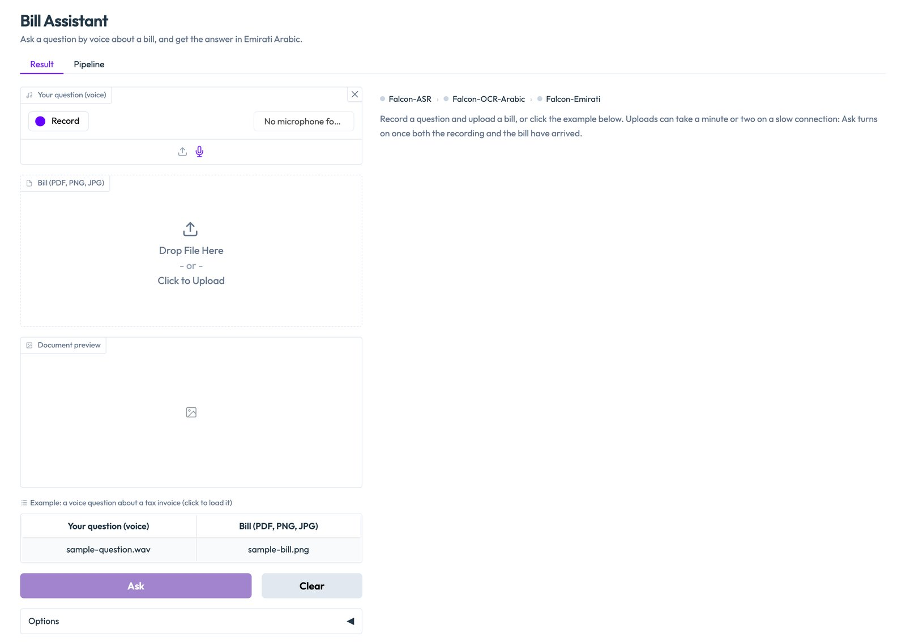
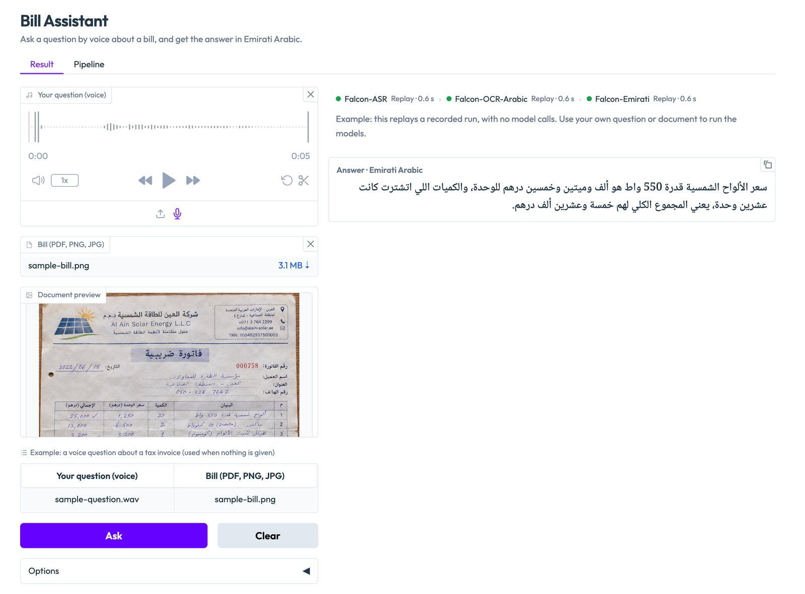
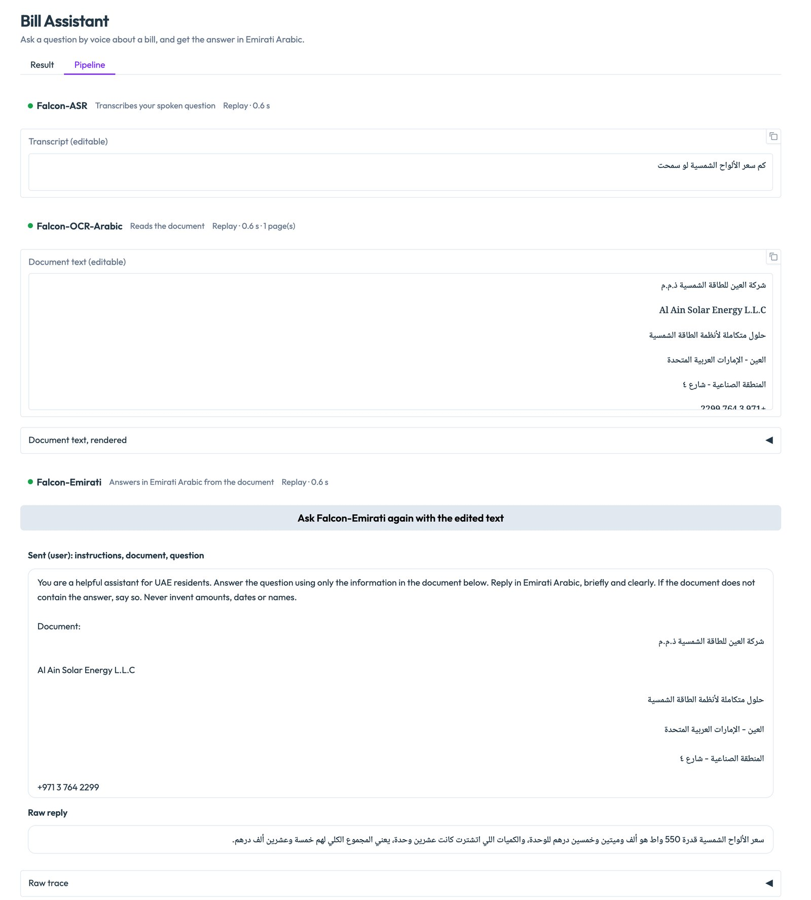

<style>
.screenshot {
  display: block;
  box-sizing: border-box;
  width: 100%;
  max-width: 100%;
  height: auto;
  object-fit: contain;
  margin: 1.5em auto;
  border-radius: 8px;
  box-shadow: 0 4px 6px rgba(0, 0, 0, 0.1);
}
.caption {
  text-align: center;
  font-size: 0.85em;
  opacity: 0.75;
  margin: -0.8em auto 1.5em;
  max-width: 100%;
}
.post-content table:not(.highlighttable, .highlight table, .gist .highlight) {
  display: table;
  width: 100% !important;
  border-collapse: separate;
  border-spacing: 0;
  border: 1px solid rgba(0, 0, 0, 0.18);
  border-radius: 8px;
  overflow: hidden;
  font-size: 0.9em;
}
.post-content table:not(.highlighttable, .highlight table, .gist .highlight) th {
  font-size: 1em;
  font-weight: 600;
  text-align: left;
  background: var(--code-bg);
}
.post-content table:not(.highlighttable, .highlight table, .gist .highlight) th,
.post-content table:not(.highlighttable, .highlight table, .gist .highlight) td {
  padding: 10px 14px;
  text-align: left;
  vertical-align: top;
  border-bottom: 1px solid rgba(0, 0, 0, 0.18);
  border-right: 1px solid rgba(0, 0, 0, 0.18);
}
.post-content table:not(.highlighttable, .highlight table, .gist .highlight) th:last-child,
.post-content table:not(.highlighttable, .highlight table, .gist .highlight) td:last-child {
  border-right: 0;
}
.post-content table:not(.highlighttable, .highlight table, .gist .highlight) tbody tr:last-child td {
  border-bottom: 0;
}
.post-content table:not(.highlighttable, .highlight table, .gist .highlight) tbody tr:nth-child(even) td {
  background: rgba(0, 0, 0, 0.02);
}
@media (max-width: 600px) {
  .post-content table:not(.highlighttable, .highlight table, .gist .highlight) {
    display: block;
    overflow-x: auto;
  }
}
.excerpt {
  font-size: 0.85em;
  opacity: 0.85;
  margin: 0.2em 0 0.4em;
}
.excerpt code {
  font-size: 0.95em;
}
.rtl-block pre,
.rtl-block code,
.rtl-block .line {
  unicode-bidi: plaintext;
  text-align: start;
}
.rtl-block .line {
  display: block;
}
</style>

## Introduction

An invoice has several numbers that can answer different versions of the same question. “How much are the solar panels?” might mean the price of one panel or the cost of all twenty. A useful assistant has to find the right line, keep those two amounts separate, and give an answer the reader can check.

This tutorial follows a small Gradio app that takes a spoken question and a photo or PDF of a bill. Falcon-ASR transcribes the question, Falcon-OCR-Arabic reads the document, and Falcon-Emirati answers in Emirati Arabic from the two texts. The app shows each intermediate result because a fluent answer is not evidence that the figures are right.

## The example bill

The sample is a tax invoice from a solar installer in Al Ain. It lists twenty 550 W panels, two inverters, a mounting frame, cables and installation, followed by VAT. The spoken question is *"كم سعر الألواح الشمسية لو سمحت؟"* (“How much do the solar panels cost, please?”). The relevant row lists AED 1,250 per panel and AED 25,000 for all twenty.

That is a modest lookup task, but there are two places to go wrong before the answer is written: speech recognition can change the question, and OCR can change a digit or attach it to the wrong row. The **Pipeline** tab exposes both texts; the **Result** tab keeps the inputs, model status and answer together.





<p class="caption">Before a run. Click the example to load the recorded question and bill, then press <strong>Ask</strong>.</p>


<p class="caption">The recorded example shows the bill, the question and the answer together.</p>

You can try that example without keys or a GPU. It replays a saved run. Your own question and bill use the live model endpoints, which need the access described below.

## How the three steps fit together

The two inputs can be processed at the same time:

1. **[Falcon-ASR](https://huggingface.co/blog/tiiuae/falcon-asr)** (1.6B) turns the audio into a transcript. Its weights cover Emirati Arabic, Modern Standard Arabic, other Gulf dialects and English, so the app does not ask you to pick a language.
2. **[Falcon-OCR-Arabic](https://huggingface.co/blog/tiiuae/falcon-ocr-arabic)** (270M) extracts text from each bill page, including HTML tables. If its URL and key are absent, the app uses **[Falcon-OCR](https://huggingface.co/tiiuae/Falcon-OCR)** (270M) on the public vision gateway.
3. **[Falcon-Emirati](https://huggingface.co/blog/tiiuae/falcon-emirati)** (7B) receives the transcript and extracted bill text. It writes an answer in Emirati Arabic without receiving the audio or image.


<p class="caption">Speech and OCR run together; Falcon-Emirati waits for both texts.</p>

The handoff to Falcon-Emirati is plain text. That makes the boundary easy to inspect: if a panel price is wrong in the OCR text, the problem happened before answer generation. You can correct either text after the first answer and run only Falcon-Emirati again.

## Run the example

The [Space](https://huggingface.co/spaces/tiiuae/bill-assistant) hosts the app and its **Files** tab contains the code. To run the same app locally, clone the Space and use Python 3.12 with [uv](https://docs.astral.sh/uv/):

```bash
git clone https://huggingface.co/spaces/tiiuae/bill-assistant
cd bill-assistant
uv sync
uv run python app.py
```

If the Space stores the sample bill with Git LFS/Xet, install [git-lfs](https://git-lfs.com) before cloning. A pointer file in place of `assets/sample-bill.png` will not match the recorded example. For voice uploads other than WAV, such as mp3 or m4a, install [ffmpeg](https://ffmpeg.org); the Space gets it from `packages.txt`.

Open `http://127.0.0.1:7860`, click the example under the inputs to load `assets/sample-question.wav` and `assets/sample-bill.png`, and press **Ask**. The app replays the transcript, OCR text and answer from `assets/sample-bill.recording.json`. It makes no model calls. Replay requires both files to match the samples byte for byte; a different question or bill takes the live path.

On that live path, the recording goes to Falcon-ASR and the bill goes to Falcon-OCR-Arabic or the public vision gateway. Falcon-Emirati receives their text outputs. Use test documents when trying the endpoints.

### Model access

The public Falcon-OCR gateway needs no key. Falcon-ASR, Falcon-OCR-Arabic and Falcon-Emirati each need a bearer key; the last two also need an endpoint URL:

| Model | Variables | Without them |
| --- | --- | --- |
| Falcon-ASR | `FALCON_ASR_API_KEY` | Your own questions can't be transcribed; the example still replays |
| Falcon-OCR-Arabic | `FALCON_ARABIC_OCR_URL`, `FALCON_ARABIC_OCR_API_KEY` | Falcon-OCR on the gateway reads the bill |
| Falcon-Emirati | `FALCON_LLM_URL`, `FALCON_LLM_API_KEY` | The answer quotes the bill text, with a `Not configured` badge |

Ask for access through the [TII contact form](https://www.tii.ae/contact-us), naming the model. You can try the [Falcon-ASR demo](https://huggingface.co/spaces/tiiuae/falcon-asr-demo), the [Falcon-OCR-Arabic playground](https://ocr.arabic.aidrc.tii.ae/) and [Falcon Chat](https://chat.falconllm.tii.ae/?model=Falcon-Emirati-7B) without these API keys. The [Falcon Discord](https://discord.gg/Cbek57PrZE) is another place to ask about access.

For a local live run, put the values in a `.env` file next to `app.py` (gitignored and loaded at startup), or export them in your shell:

```bash
FALCON_ASR_API_KEY=<key>
FALCON_ARABIC_OCR_URL=https://<host>/v1/ocr
FALCON_ARABIC_OCR_API_KEY=<key>
FALCON_LLM_URL=https://<host>/v1
FALCON_LLM_API_KEY=<key>
```

The app supplies defaults for the remaining settings:

| Name | Default | What it does |
| --- | --- | --- |
| `FALCON_ASR_URL`, `FALCON_OCR_URL` | TII endpoints | Falcon-ASR and vision gateway URLs |
| `FALCON_LLM_MODEL` | `falcon-h1-7b-emirati` | Falcon-Emirati model id (Falcon-Emirati-7B) |
| `OCR_TASK` | `ocr_plain` | `ocr_plain` or `ocr_layout`, for Falcon-OCR only |
| `APP_PASSWORD` | unset | Turns on a login with the user `demo` |
| `MAX_DOC_MB`, `MAX_AUDIO_SECONDS`, `QUEUE_CONCURRENCY` | `10`, `60`, `4` | Bill size, question length, concurrent runs |

Restart the app after changing the variables. The **Result** tab then shows which models are configured for live calls.

### Files

```text
bill-assistant/
  app.py                 Gradio UI: the Result and Pipeline tabs
  pipeline.py            runs the three steps and records each one's status and output
  config.py              environment variables and defaults
  record_example.py      records the example's run
  ui_helpers.py          theme, CSS and HTML rendering
  alerts.py              optional Slack alerts for the endpoints
  services/
    asr.py               Falcon-ASR
    ocr.py               Falcon-OCR-Arabic, with Falcon-OCR on the gateway
    vision.py            client for the public vision gateway
    llm.py               Falcon-Emirati
    fixtures.py          replay of the example
  assets/
    sample-question.wav
    sample-bill.png
    sample-bill.recording.json
```

## Transcribe the question with Falcon-ASR

The first question for the pipeline is whether ASR heard the right item. The app uploads the audio to `/api/transcription/transcribe` as multipart data. A `429` or `409` response triggers a wait based on `Retry-After`; a `5xx` response gets a short pause. The request is attempted at most three times:

<p class="excerpt"><strong>Excerpt</strong> from <a href="https://huggingface.co/spaces/tiiuae/bill-assistant/blob/main/services/asr.py"><code>services/asr.py</code></a>: <code>_transcribe_live</code></p>

```python
headers = {
    "Authorization": f"Bearer {cfg.api_key}",
    "Idempotency-Key": str(uuid.uuid4()),
}

response: requests.Response | None = None
for delay in (1, 2, None):
    with path.open("rb") as audio:
        response = requests.post(
            url,
            headers=headers,
            files={"audio_file": (path.name, audio, mime)},
            data={"audio_source": "file_upload"},
            timeout=(10, 330),
        )
    if response.status_code in (429, 409) and delay is not None:
        time.sleep(_retry_after_seconds(response.headers.get("Retry-After")))
        continue
    if response.status_code >= 500 and delay is not None:
        time.sleep(delay)
        continue
    break
```

The attempts reuse one `Idempotency-Key`. That gives the endpoint a way to recognize a retry, although duplicate prevention depends on the endpoint honoring the header. A successful response has `status` set to `"ok"` and the words in `transcription`. For the sample's five-second clip, the saved transcript is:

<div class="rtl-block">

```text
كم سعر الألواح الشمسية لو سمحت
```
</div>

## Read the bill with Falcon-OCR-Arabic

OCR has a different job: preserve the relationship between a line item, its quantity, its unit price and its total. Falcon-OCR-Arabic accepts images, so the app sends a photo as it is. For a PDF, PyMuPDF renders up to eight pages as JPEGs at 150 DPI. Each page gets its own multipart request:

<p class="excerpt"><strong>Excerpt</strong> from <a href="https://huggingface.co/spaces/tiiuae/bill-assistant/blob/main/services/ocr.py"><code>services/ocr.py</code></a>: <code>_arabic_image</code> (abridged)</p>

```python
with image_path.open("rb") as handle:
    response = httpx.post(
        config.ARABIC_OCR_URL,
        headers={"Authorization": f"Bearer {config.ARABIC_OCR_API_KEY}"},
        files={"file": (image_path.name, handle, mime)},
        timeout=config.ARABIC_OCR_TIMEOUT_S,
    )
    # ...
    response.raise_for_status()
    payload = response.json()
```

When `FALCON_ARABIC_OCR_URL` and `FALCON_ARABIC_OCR_API_KEY` are set, **Enhance Arabic** under **Options** starts on. Without them, the option is disabled and Falcon-OCR on the public gateway reads the pages. A quota response from Falcon-OCR-Arabic also sends the whole document through Falcon-OCR. For a multipage bill, `--- page N ---` markers keep the extracted pages separate in the text passed to Falcon-Emirati.

In the recorded run, Falcon-OCR-Arabic returned the invoice header, customer details and notes as text, with the item and totals tables as HTML. The **Pipeline** tab renders the item table below; only the column headings have been translated here:

| # | Item | Qty | Unit price (AED) | Total (AED) |
| --- | --- | --- | --- | --- |
| 1 | ألواح شمسية قدرة 550 واط | 20 | 1,250 | 25,000 ✓ |
| 2 | عاكس (Inverter) 10 كيلوواط | 2 | 6,500 | 13,000 |
| 3 | هيكل تثبيت الألواح (ألومنيوم) | 1 | 3,200 | 3,200 - |
| 4 | كابلات وملحقات التركيب | 1 | 2,150 | 2,150 |
| 5 | أعمال التركيب والتشغيل | 1 | 5,000 | 5,000 ✓ |

The handwritten marks next to some totals appear as `✓`. The other table contains a subtotal of AED 48,350, VAT of AED 2,417.50 at 5%, and a final total of AED 50,767.50. The panel question calls for the first row, not the invoice total.

## Ask Falcon-Emirati

Once both texts are available, Falcon-Emirati needs to connect the question to the right row. The app puts its instructions, the extracted bill text and the transcript into one user message. The endpoint applies its own system prompt, so the app sends its instructions in that user message:

<p class="excerpt"><strong>Excerpt</strong> from <a href="https://huggingface.co/spaces/tiiuae/bill-assistant/blob/main/services/llm.py"><code>services/llm.py</code></a>: <code>INSTRUCTIONS</code> and <code>build_message</code></p>

```python
INSTRUCTIONS = (
    "You are a helpful assistant for UAE residents. Answer the question using only "
    "the information in the document below. Reply in Emirati Arabic, briefly and "
    "clearly. If the document does not contain the answer, say so. Never invent "
    "amounts, dates or names."
)


def build_message(question: str, document_text: str) -> str:
    return (
        f"{INSTRUCTIONS}\n\n"
        f"Document:\n{document_text.strip()}\n\n"
        f"Question:\n{question.strip()}"
    )
```

The endpoint uses the OpenAI chat-completions protocol. The app calls it through the `openai` client with model id `falcon-h1-7b-emirati` and uses the returned content as the answer.

The recorded answer to the example question is:

<blockquote dir="rtl" lang="ar">
<p>سعر الألواح الشمسية قدرة 550 واط هو ألف وميتين وخمسين درهم للوحدة، والكميات اللي اتشترت كانت عشرين وحدة، يعني المجموع الكلي لهم خمسة وعشرين ألف درهم.</p>
</blockquote>

In English, it says the 550 W panels cost AED 1,250 each and the twenty panels cost AED 25,000 together. That matches the first row: 20 × 1,250 = 25,000. The answer also gives both figures in words, which suits a spoken question.

If `FALCON_LLM_URL` or `FALCON_LLM_API_KEY` is missing, this step makes no model call. It shows the extracted bill text with a `Not configured` notice instead of inventing an answer.

## Keep the steps inspectable

Speech and OCR do not depend on each other, so `run_pipeline` starts them together. Falcon-Emirati begins only after both succeed. The pipeline yields a fresh trace after each state change, and the UI renders its status and outputs from that trace:

<p class="excerpt"><strong>Excerpt</strong> from <a href="https://huggingface.co/spaces/tiiuae/bill-assistant/blob/main/pipeline.py"><code>pipeline.py</code></a>: <code>run_pipeline</code> (abridged)</p>

```python
trace = new_trace(enhance_arabic)
replay = fixtures.replays(doc_path, audio_path)
# ...
with ThreadPoolExecutor(2) as pool:
    futures = {
        pool.submit(asr.transcribe, audio_path, replay): "asr",
        pool.submit(ocr.run_ocr, doc_path, enhance_arabic, replay): "ocr",
    }
    for future in as_completed(futures):
        _record(trace, futures[future], future.result)
        yield copy.deepcopy(trace)

if trace["asr"]["status"] == "done" and trace["ocr"]["status"] == "done":
    yield from _run_llm(
        trace, trace["asr"]["output"]["text"], trace["ocr"]["output"]["text"], replay
    )
else:
    trace["llm"]["status"] = "skipped"
    yield copy.deepcopy(trace)
```

Each trace entry has a status, model, timing, error and output; it contains no API key. If speech or OCR fails, the Falcon-Emirati step is marked `skipped`. It does not answer from the one input that happened to succeed.

The example follows the same path using saved outputs. `record_example.py` made live calls on the sample question and invoice, then stored the transcript, bill text and reply. Replay checks the bytes of both inputs, so the recorded answer cannot be reused for a different bill or question. After changing a sample, the prompt or a model, refresh the recording with the endpoints configured:

```bash
uv run python record_example.py
```

## Check the answer in the app

The **Result** tab puts the voice question, bill preview, example and **Ask** and **Clear** buttons on the left. Model status and timing sit beside the Emirati Arabic answer on the right, including whether each step ran live or replayed a recording.

The **Pipeline** tab is where to investigate a doubtful answer. Check the transcript first, then the extracted row and amount. You can edit either text and press **Ask Falcon-Emirati again with the edited text**. That runs only the final step. The tab also shows the exact message sent to Falcon-Emirati and its raw reply.


<p class="caption">The Pipeline tab shows the transcript, OCR text, message and reply for the recorded run.</p>

Try the [Space](https://huggingface.co/spaces/tiiuae/bill-assistant) with a test bill and your own question, or clone it to run the example locally. The recorded answer shows that this one question reached the right invoice row. For a new bill, the useful check is still the same: compare the transcript, the extracted amount and the answer with what is printed on the page.

## References

- [Bill Assistant Space](https://huggingface.co/spaces/tiiuae/bill-assistant): the app and its code.
- [Falcon-ASR](https://huggingface.co/blog/tiiuae/falcon-asr): announcement post, and the [Falcon-ASR demo Space](https://huggingface.co/spaces/tiiuae/falcon-asr-demo).
- [Falcon-OCR-Arabic](https://huggingface.co/blog/tiiuae/falcon-ocr-arabic): announcement post. The default reader when its endpoint is configured.
- [Falcon-OCR](https://huggingface.co/tiiuae/Falcon-OCR): model card and weights. The reader on the public vision gateway.
- [Falcon-Emirati](https://huggingface.co/blog/tiiuae/falcon-emirati) and its [model page](https://falconllm.tii.ae/falcon-emirati.html).
- [TII announcement: Falcon-Emirati, Falcon-ASR and Falcon-OCR-Arabic](https://www.wam.ae/a/c2mg25j)
- [TII contact form](https://www.tii.ae/contact-us), to request access to the models.
- [Gradio docs](https://www.gradio.app/docs), [uv](https://docs.astral.sh/uv/) and [PyMuPDF](https://pymupdf.readthedocs.io/).
