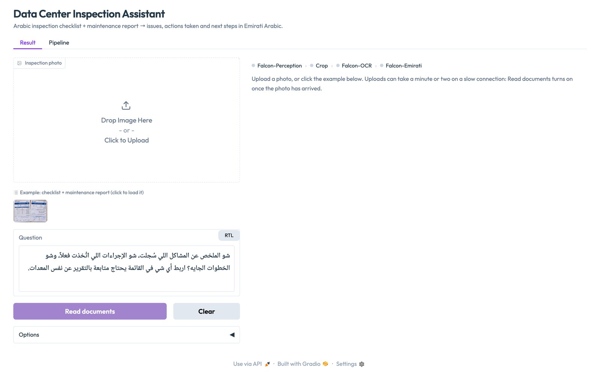
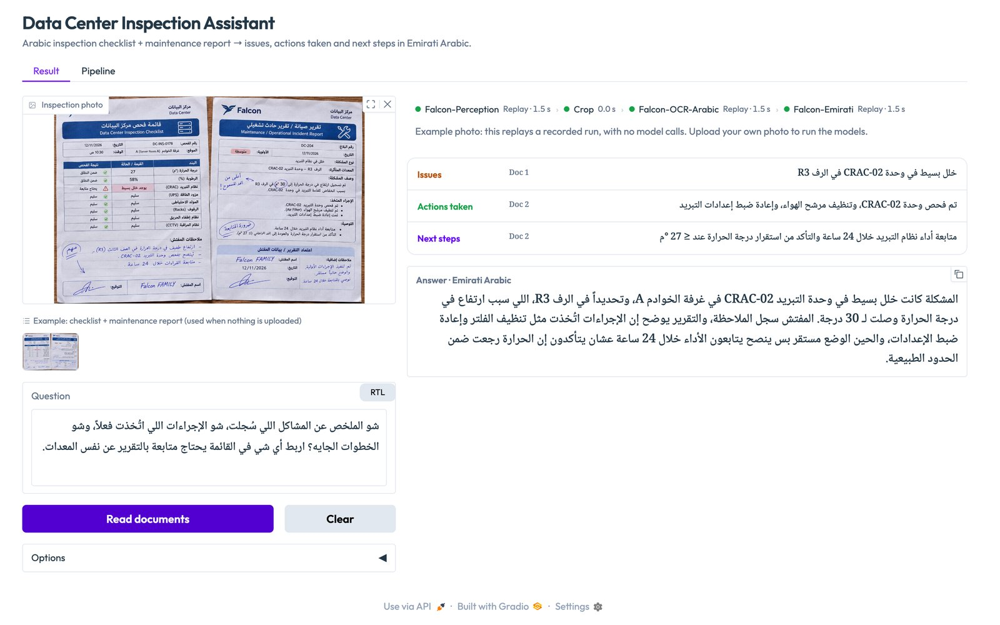
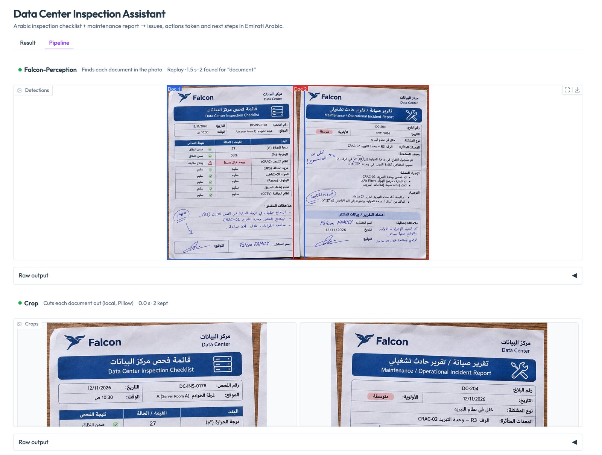
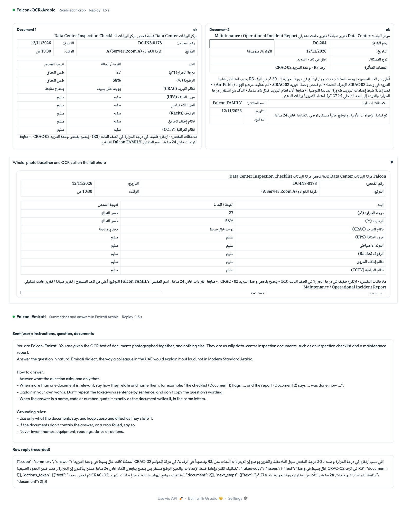

<style>
.screenshot {
  display: block;
  box-sizing: border-box;
  width: 100%;
  max-width: 100%;
  height: auto;
  object-fit: contain;
  margin: 1.5em auto;
  border-radius: 8px;
  box-shadow: 0 4px 6px rgba(0, 0, 0, 0.1);
}
.caption {
  text-align: center;
  font-size: 0.85em;
  opacity: 0.75;
  margin: -0.8em auto 1.5em;
  max-width: 100%;
}
.post-content table:not(.highlighttable, .highlight table, .gist .highlight) {
  display: table;
  width: 100% !important;
  border-collapse: separate;
  border-spacing: 0;
  border: 1px solid rgba(0, 0, 0, 0.18);
  border-radius: 8px;
  overflow: hidden;
  font-size: 0.9em;
}
.post-content table:not(.highlighttable, .highlight table, .gist .highlight) th {
  font-size: 1em;
  font-weight: 600;
  text-align: right;
  background: var(--code-bg);
}
.post-content table:not(.highlighttable, .highlight table, .gist .highlight) th,
.post-content table:not(.highlighttable, .highlight table, .gist .highlight) td {
  padding: 10px 14px;
  text-align: right;
  vertical-align: top;
  border-bottom: 1px solid rgba(0, 0, 0, 0.18);
  border-left: 1px solid rgba(0, 0, 0, 0.18);
}
.post-content table:not(.highlighttable, .highlight table, .gist .highlight) th:last-child,
.post-content table:not(.highlighttable, .highlight table, .gist .highlight) td:last-child {
  border-left: 0;
}
.post-content table:not(.highlighttable, .highlight table, .gist .highlight) tbody tr:last-child td {
  border-bottom: 0;
}
.post-content table:not(.highlighttable, .highlight table, .gist .highlight) tbody tr:nth-child(even) td {
  background: rgba(0, 0, 0, 0.02);
}
@media (max-width: 600px) {
  .post-content table:not(.highlighttable, .highlight table, .gist .highlight) {
    display: block;
    overflow-x: auto;
  }
}
.excerpt {
  font-size: 0.85em;
  opacity: 0.85;
  margin: 0.2em 0 0.4em;
}
.excerpt code {
  font-size: 0.95em;
}
/* Keep code left-to-right inside the RTL article */
.post-content [dir="rtl"] pre,
.post-content [dir="rtl"] pre code {
  direction: ltr;
  text-align: left;
}
.post-content [dir="rtl"] :not(pre) > code {
  direction: ltr;
  unicode-bidi: isolate;
}
.post-content [dir="rtl"] pre .line {
  unicode-bidi: plaintext;
}
</style>

<div dir="rtl">

قد تحتوي صور الفحص الميداني على عدة مستندات في آن واحد. فقد تسجّل قائمة الفحص عطلًا، بينما يصف تقرير الصيانة ما فعله التقني لمعالجته. وقراءة النص ليست سوى جزء من المهمة: إذ يحتاج المساعد أيضًا إلى ربط كل ملاحظة بالورقة التي تدعمها.

يتتبّع هذا الدرس صورة من هذا النوع عبر مساعد للمستندات العربية. نوضّح فيه لماذا يفصل التطبيق الأوراق قبل التعرّف الضوئي على النصوص (OCR)، وكيف يحوّل محتواها إلى قائمة إجراءات.

## صورة الفحص

في الصورة النموذجية، تُشير قائمة الفحص إلى أن نظام التبريد يحتاج إلى متابعة. وبجانبها تقرير صيانة يذكر أن تقنيًا فحص وحدة CRAC-02، ونظّف فلتر الهواء فيها، وأعاد ضبط إعدادات التبريد. والمُخرج المفيد هنا هو قائمة إجراءات: ما المشكلة التي سُجّلت، وما الذي تم فعله، وما الذي لا يزال يحتاج إلى فحص. كما يجب أن توضّح القائمة أي ورقة تدعم كل بند.

نبني تطبيق Gradio للحصول على هذه الإجابة من الصورة. يجد Falcon-Perception المستندين، وتقتصّهما مكتبة Pillow، ويقرأ Falcon-OCR-Arabic كل صورة مقتصّة، ثم يكتب Falcon-Emirati الإجابة باللهجة الإماراتية. ويُرفق التطبيق كل خلاصة بالمستند الذي جاء منه.





<p class="caption">التطبيق قبل التشغيل. انقر على المثال لتحميل الصورة النموذجية، ثم اضغط <strong>Read documents</strong>.</p>


<p class="caption">تستشهد عملية التشغيل المسجّلة بقائمة الفحص للمشكلة، وبالتقرير للإجراءات والخطوات التالية.</p>

تحتاج إلى Python وطرفية (terminal) لتشغيل التطبيق محليًا، لكنك لا تحتاج إلى وحدة معالجة رسومات (GPU). يستخدم Falcon-Perception وFalcon-OCR بوابة عامة دون مفتاح، بينما يحتاج Falcon-OCR-Arabic وFalcon-Emirati إلى نقاط نهاية خاصة. ويعرض المثال الافتراضي نتائج عملية تشغيل مسجّلة دون استدعاء أي نقطة نهاية للنماذج، لذا فهو يعمل دون مفاتيح نقاط النهاية الخاصة.

## لماذا نفصل المستندات؟

يقرأ التعرّف الضوئي على الصورة كاملةً قائمةَ الفحص والتقرير كتدفّق نصي واحد. أما قراءات الصور المقتصّة فتُبقيهما منفصلين: يحتوي المستند 1 على حالة التبريد في قائمة الفحص وملاحظة المتابعة، بينما يحتوي المستند 2 على إجراءات الصيانة والتوصية. ويحتفظ التطبيق بقراءة الصورة الكاملة في تبويب Pipeline كمرجع للمقارنة (baseline)، ويرسل نصّي الصورتين المقتصّتين المُعنونتين إلى Falcon-Emirati.

يمنح فصل الأوراق النموذجَ عنوانًا لمصدر كل كتلة نصية. ويمكنه استخدام هذه العناوين في الإجابة والخلاصات، فيتمكّن القارئ من الانتقال من بند في الملخص إلى المستند الذي يستند إليه.

## من الصورة إلى الإجابة

يُشغّل التطبيق أربع خطوات:

1. **[Falcon-Perception](https://huggingface.co/tiiuae/Falcon-Perception)** (0.6B) يأخذ الصورة والاستعلام `document`، ويُعيد مربعًا محيطًا (box) وقناعًا (mask) لكل مستند يجده.
2. **الاقتصاص (Crop)** يعمل داخل تطبيق Gradio باستخدام Pillow، فيُرشّح المربعات ويحفظ صورة واحدة لكل مستند.
3. **[Falcon-OCR-Arabic](https://huggingface.co/blog/tiiuae/falcon-ocr-arabic)** (270M) يقرأ كل صورة مقتصّة، والصورة الكاملة كمرجع للمقارنة. وفي غياب عنوانه ومفتاحه، أو عند بلوغ حدّ الطلبات الخاص به، يتولّى **[Falcon-OCR](https://huggingface.co/tiiuae/Falcon-OCR)** (270M) على البوابة العامة القراءة بدلًا منه.
4. **[Falcon-Emirati](https://huggingface.co/blog/tiiuae/falcon-emirati)** (7B) يستقبل نصوص الـ OCR والسؤال، ويُعيد إجابة مع الخلاصات، يستشهد كلٌّ منها بمستنده. ولا يرى الصورة أبدًا.


<p class="caption">ما تسلّمه كل خطوة إلى التي تليها، وأين تعمل.</p>

الحدود بين الخطوات بسيطة: يُعيد Perception المواقع، ويكتب الاقتصاص ملفات صور، ويُعيد الـ OCR نصًا. وعندما يكون الـ OCR العربي غير مهيّأ أو تنفد حصته، يمكن للتطبيق استخدام Falcon-OCR دون تغيير خطوة الكشف أو خطوة الإجابة.

يعرض تبويب **Result** الإجابة والخلاصات، بينما يعرض تبويب **Pipeline** نتائج الكشف والصور المقتصّة ونص الـ OCR ورد النموذج الذي يقف خلفها.

## تشغيل المثال

يُشغّل الـ [Space](https://huggingface.co/spaces/tiiuae/data-center-inspection-assistant) التطبيقَ مع تهيئة النماذج الخاصة. ويحتوي تبويب **Files** فيه على الشيفرة، ويمكنك نسخ الـ Space لتشغيله محليًا. ستحتاج إلى Python 3.12 و[uv](https://docs.astral.sh/uv/):

```bash
git clone https://huggingface.co/spaces/tiiuae/data-center-inspection-assistant
cd data-center-inspection-assistant
uv sync
uv run python app.py
```

إذا كانت الصورة النموذجية مخزّنة باستخدام Git LFS/Xet في الـ Space، فثبّت [git-lfs](https://git-lfs.com) قبل النسخ. فبدونه قد يكون الملف المنسوخ `assets/sample-inspection.png` ملف مؤشر (pointer file)، وستفشل إعادة العرض لأن التطبيق يتحقق من البايتات الدقيقة للصورة.

افتح `http://127.0.0.1:7860`، وانقر على المثال أسفل المُدخل لتحميل `assets/sample-inspection.png`، ثم اضغط **Read documents**. يعيد التطبيق عرض المخرجات الموجودة في `assets/sample-inspection.recording.json` دون أي استدعاء للنماذج. وتتطلب إعادة العرض السؤال الافتراضي أيضًا، لأن الإجابة المحفوظة تجيب عن هذا السؤال. أما الصورة أو السؤال المختلفان فيُشغّلان النماذج.

تذهب الصورة المرفوعة إلى بوابة الرؤية العامة التابعة لـ TII، وإلى نقطة نهاية Falcon-OCR-Arabic عند تهيئتها. ويستقبل Falcon-Emirati النص المستخرج، لا الصورة. استخدم مستندات تجريبية أثناء تجربة المسار المباشر.

### الوصول إلى النماذج

لا يحتاج Falcon-Perception وFalcon-OCR إلى مفتاح على البوابة العامة. أما نموذجا الـ OCR العربي والإماراتي فيحتاج كل منهما إلى عنوان نقطة نهاية خاصة ومفتاح يُرسل بصيغة `Authorization: Bearer`:

| النموذج | المتغيرات | في غيابها |
| --- | --- | --- |
| Falcon-OCR-Arabic | `FALCON_ARABIC_OCR_URL`، `FALCON_ARABIC_OCR_API_KEY` | يقرأ Falcon-OCR على البوابة الصور المقتصّة |
| Falcon-Emirati | `FALCON_LLM_URL`، `FALCON_LLM_API_KEY` | تعرض الإجابة نص الـ OCR، مع شارة `Not configured` |

اطلب الوصول عبر [نموذج التواصل الخاص بـ TII](https://www.tii.ae/contact-us)، مع ذكر اسم النموذج الذي تحتاجه. وتتيح لك [منصة تجربة Falcon-OCR-Arabic](https://ocr.arabic.aidrc.tii.ae/) و[Falcon Chat](https://chat.falconllm.tii.ae/?model=Falcon-Emirati-7B) تجربة النماذج قبل حصولك على المفاتيح. كما يوجد [خادم Falcon على Discord](https://discord.gg/Cbek57PrZE) للأسئلة.

للتشغيل المباشر محليًا، ضع قيم نقاط النهاية في ملف `.env` بجانب `app.py` (وهو مستثنى في gitignore ويُحمَّل عند بدء التشغيل)، أو صدّرها في الطرفية (shell):

```bash
FALCON_ARABIC_OCR_URL=https://<host>/v1/ocr
FALCON_ARABIC_OCR_API_KEY=<key>
FALCON_LLM_URL=https://<host>/v1
FALCON_LLM_API_KEY=<key>
```

ولبقية الإعدادات قيم افتراضية:

| الاسم | القيمة الافتراضية | الوظيفة |
| --- | --- | --- |
| `FALCON_PERCEPTION_URL`، `FALCON_OCR_URL` | البوابة العامة | عنوان بوابة الرؤية |
| `FALCON_LLM_MODEL` | `falcon-h1-7b-emirati` | معرّف نموذج Falcon-Emirati (Falcon-Emirati-7B) |
| `PERCEPTION_TASK` | `segment` | `segment` (مربعات وأقنعة) أو `detect` (مربعات فقط) |
| `OCR_TASK` | `ocr_plain` | `ocr_plain` أو `ocr_layout`، لـ Falcon-OCR فقط |
| `APP_PASSWORD` | غير مضبوط | يفعّل تسجيل الدخول باسم المستخدم `demo` |
| `MAX_IMAGE_MB`، `MAX_CROPS`، `QUEUE_CONCURRENCY` | `10`، `8`، `4` | حجم الرفع، وعدد المستندات في الصورة، وعدد عمليات التشغيل المتزامنة |
| `FALCON_LLM_TIMEOUT_S`، `FALCON_ARABIC_OCR_TIMEOUT_S`، `VISION_TIMEOUT_S` | `120`، `320`، `600` | مُهَل الطلبات بالثواني |

بعد إعادة التشغيل، يعرض تبويب Result النماذج التي تعمل مباشرة. ويبقى Falcon-Emirati في حالة `Not configured` حتى يُضبط عنوانه ومفتاحه كلاهما.

### الملفات

```text
data-center-inspection-assistant/
  app.py                 Gradio UI: the Result and Pipeline tabs
  pipeline.py            runs the four steps and records each one's status and output
  crop.py                cuts each detected document out of the photo
  config.py              environment variables and defaults
  record_example.py      records the example photo's run
  ui_helpers.py          theme, CSS and HTML rendering
  services/
    vision.py            client for the public vision gateway
    perception.py        Falcon-Perception
    ocr.py               Falcon-OCR-Arabic, with Falcon-OCR as the fallback
    llm.py               Falcon-Emirati
    fixtures.py          replay of the example photo
  assets/
    sample-inspection.png
    sample-inspection.recording.json
```

## التواصل مع بوابة الرؤية

يستخدم Falcon-Perception وFalcon-OCR الاحتياطي البوابة العامة نفسها. ولا يمكن بدء مهمة بملف صورة وحده: إذ يرفع العميل الصورة أولًا، ثم يرسل معرّف الصورة الذي أعادته البوابة مع طلب المهمة.

<p class="excerpt"><strong>مقتطف</strong> من <a href="https://huggingface.co/spaces/tiiuae/data-center-inspection-assistant/blob/main/services/vision.py"><code>services/vision.py</code></a>: <code>Gateway.run</code></p>

```python
def run(self, image_path: str, task: str, query: str) -> dict:
    path_name = TASK_TO_PATH.get((task or "").strip().lower())
    # ...
    image_id = self._ensure_uploaded(path, force=False)
    response = self._post_task(path_name, image_id, query)
    if response.status_code == 404:
        image_id = self._ensure_uploaded(path, force=True)
        response = self._post_task(path_name, image_id, query)
    _raise_for_status(response)
    return _json_body(response)
```

يحتفظ `Gateway` بمعرّف الصورة الذي أعاده الرفع، ويتحقق مما إذا كانت الصورة نفسها متاحة بالفعل قبل رفعها مجددًا. وإذا لم تعد الصورة موجودة لدى البوابة، يرفعها العميل مرة أخرى ويعيد محاولة المهمة مرة واحدة.

## إيجاد المستندات باستخدام Falcon-Perception

قبل الكشف، تطبّق الدالة `prepare_image` اتجاه EXIF وتحفظ صورة JPEG للعمل عليها. فقد تخزّن صور الهاتف الدوران في البيانات الوصفية بينما تبقى البكسلات نفسها مُدارة؛ واستخدام الصورة المعدّلة الاتجاه يُبقي المربعات المُعادة متوافقة مع البكسلات التي نقتصّها لاحقًا.

<p class="excerpt"><strong>مقتطف</strong> من <a href="https://huggingface.co/spaces/tiiuae/data-center-inspection-assistant/blob/main/crop.py"><code>crop.py</code></a>: <code>prepare_image</code></p>

```python
def prepare_image(image_path: str, dest: Path) -> str:
    """Apply EXIF orientation and write a working JPEG."""
    with Image.open(image_path) as image:
        oriented = ImageOps.exif_transpose(image).convert("RGB")
        dest.parent.mkdir(parents=True, exist_ok=True)
        oriented.save(dest, format="JPEG", quality=92)
    return str(dest)
```

تذهب بعد ذلك الصورة المعدّلة الاتجاه والاستعلام `document` إلى `/segment`. وتستخدم المربعات التي يُعيدها إحداثيات `[x1, y1, x2, y2]` بحسب حجم الصورة لدى البوابة. نقوم بتحجيمها لتطابق صورة العمل، ونخزّن المراكز والأحجام بعد تطبيعها. وفي وضع `segment`، تتضمن كل نتيجة كشف أيضًا قناعًا لعزل الأوراق المتداخلة.

<p class="excerpt"><strong>مقتطف</strong> من <a href="https://huggingface.co/spaces/tiiuae/data-center-inspection-assistant/blob/main/services/perception.py"><code>services/perception.py</code></a>: <code>_localise_live</code> (مختصر)</p>

```python
with vision.Gateway(cfg) as gateway:
    payload = gateway.run(image_path, config.PERCEPTION_TASK, query)

src_w = int(payload.get("image_width") or local_w) or local_w
src_h = int(payload.get("image_height") or local_h) or local_h
scale_x = local_w / src_w if src_w else 1.0
scale_y = local_h / src_h if src_h else 1.0

for item in payload.get("masks") or []:
    # ...
    detections.append(
        Detection(
            center=[((x1 + x2) / 2) / local_w, ((y1 + y2) / 2) / local_h],
            size=[(x2 - x1) / local_w, (y2 - y1) / local_h],
            score=_score(item),
            mask=mask,
        )
    )
```

لا تحتوي نتائج الكشف هذه من البوابة على قيمة ثقة، لذلك تستخدم الدالة `_score` القيمة `1.0`. وفي المثال، يجد Perception قائمة الفحص والتقرير:


<p class="caption">أعلى تبويب Pipeline: نتيجتا كشف، ثم الصورتان المقتصّتان المُرسلتان إلى الـ OCR.</p>

## اقتصاص كل مستند

يحتاج الـ OCR إلى صورة لكل ورقة مكتشفة. تستبعد الدالة `crop_documents` أولًا المربعات التي تشغل أقل من 1% من الصورة. وفي الوضع الافتراضي، تستبعد أيضًا أي مربع تبلغ نسبة التقاطع إلى الاتحاد (IoU) بينه وبين مربع محتفَظ به مسبقًا 0.7 أو أكثر. ولأن البوابة تمنح هذه المربعات الدرجة نفسها، يفوز المربع المذكور أولًا في حالة التعادل.

تُرتَّب المربعات المحتفَظ بها من الأعلى إلى الأسفل، ثم من اليسار إلى اليمين، ويُقتصر على ثمانية منها كحد أقصى، مما يحدّ من عدد طلبات الـ OCR للصور المقتصّة. ويحصل كل مربع على هامش بنسبة 4% للحفاظ على حواف المستند في صورة JPEG المحفوظة.

<p class="excerpt"><strong>مقتطف</strong> من <a href="https://huggingface.co/spaces/tiiuae/data-center-inspection-assistant/blob/main/crop.py"><code>crop.py</code></a>: <code>crop_documents</code> (مختصر)</p>

```python
for order, item in enumerate(candidates["kept"], start=1):
    box = item["box"]
    mask = item["detection"].mask
    use_seg = segmentation_only and bool(mask) and any(any(r) for r in mask)
    # ...
    padded = _pad_box(box, width, height)
    # ...
    piece = image.crop(tuple(padded))
    if use_seg:
        piece = _isolate_with_mask(
            piece, padded, item["box"], mask, width, height
        )
    piece.save(path, format="JPEG", quality=92)
```

تقع الورقتان في المثال جنبًا إلى جنب، لذا يكفي الاقتصاص المستطيل. أما الأوراق المتداخلة، فيستخدم **Segmentation mode** قناع كل ورقة على حدة (instance mask) ويحوّل البكسلات الواقعة خارجه إلى اللون الأبيض. وهذا يُبقي نص الورقة العلوية خارج الصورة المقتصّة الخاصة بالورقة التي تحتها، حيث كان المستطيل وحده سيشمل الاثنتين.

## قراءة كل صورة مقتصّة باستخدام Falcon-OCR-Arabic

يقرأ الـ OCR كل صورة مقتصّة والصورة الكاملة. ويبقى نص الصورة الكاملة في تبويب Pipeline كمرجع للمقارنة، بينما لا تذهب إلى Falcon-Emirati سوى نصوص الصور المقتصّة. وتعمل الطلبات بالتوازي بما يصل إلى أربعة عمّال (workers).

عند ضبط `FALCON_ARABIC_OCR_URL` و`FALCON_ARABIC_OCR_API_KEY`، يبدأ خيار **Enhance Arabic** مفعّلًا ويرسل الصور إلى Falcon-OCR-Arabic. وفي غياب القيمتين معًا، يكون الخيار معطّلًا ويتولّى Falcon-OCR على البوابة العامة القراءة.

يوضّح تبويب Result القارئ المُستخدم في عملية التشغيل. ولكل من نقطتَي النهاية المتاحتين بدعوة فقط حدّ في الدقيقة وحدّ يومي لكل مفتاح، وتستهلك عملية التشغيل الواحدة طلبًا واحدًا من Falcon-OCR-Arabic لكل مستند، بالإضافة إلى طلب للصورة الكاملة. وعند بلوغ أحد الحدود، تُجيب نقطة النهاية بالرمز 429 مع اسم الحد وترويسة `Retry-After`. فيقرأ التطبيق الصورة حينها باستخدام Falcon-OCR، ويوضّح الحد الذي تم بلوغه وموعد إعادة تعيينه.


<p class="caption">أسفل تبويب Pipeline: نص الـ OCR لكل مستند، وقراءة الصورة الكاملة المرجعية، ثم ما استقبله Falcon-Emirati وما أعاده.</p>

## سؤال Falcon-Emirati

يرى Falcon-Emirati السؤال وكتلة نصية مُعنونة واحدة لكل صورة مقتصّة، ولا يرى الصورة أبدًا.

يتضمّن السؤال الافتراضي مهمة الفحص المطلوبة. وتطلب التعليمات من Falcon-Emirati أن يجيب عن هذا السؤال فقط، وأن يستخدم نص الـ OCR المقدَّم، وأن يكتب باللهجة الإماراتية، وأن يُعيد JSON. ويميّز الحقل `scope` بين `summary` (ملخص) و`fact` (معلومة واحدة): فإجابات المعلومة الواحدة تترك قوائم الخلاصات فارغة، بينما تستشهد خلاصات الملخص بالمستند الذي يدعم كل بند.

<p class="excerpt"><strong>مقتطف</strong> من <a href="https://huggingface.co/spaces/tiiuae/data-center-inspection-assistant/blob/main/services/llm.py"><code>services/llm.py</code></a>: <code>INSTRUCTIONS</code></p>

```text
You are Falcon-Emirati. You are given the OCR text of documents photographed together, and nothing else. They are usually data-centre inspection documents, such as an inspection checklist and a maintenance report.
Answer the question in natural Emirati dialect, the way a colleague in the UAE would explain it out loud, not in Modern Standard Arabic.

How to answer:
- Answer what the question asks, and only that.
- When more than one document is relevant, say how they relate and name them, for example: "the checklist (Document 1) flags ..., and the report (Document 2) says ... was done; now ...".
- Explain in your own words. Don't repeat the takeaways sentence by sentence, and don't copy the question's wording.
- When the answer is a name, code or number, quote it exactly as the document writes it, in the same letters.

Grounding rules:
- Use only what the documents say, and keep cause and effect as they state it.
- If the documents don't contain the answer, or a crop failed, say so.
- Never invent names, equipment, readings, dates or actions.

Return one JSON object and no other text:
{"scope": "summary", "answer": "<Emirati Arabic answer to the question>", "takeaways": {"issues": [{"text": "<short, Emirati Arabic>", "document": 1}], "actions_taken": [{"text": "...", "document": 2}], "next_steps": [{"text": "...", "document": 2}]}}
- "scope" comes first. It is "summary" when the question asks about issues, actions taken or next steps, and "fact" when it asks for one piece of information (a name, a date, a reading).
- When scope is "fact", all three takeaway lists are empty.
- When scope is "summary", each takeaway cites the one document its text comes from. Leave a list empty when the documents say nothing for it.
```

يطلب السؤال الافتراضي ملخص الفحص وربطًا بين قائمة الفحص والتقرير:

<p class="excerpt"><strong>مقتطف</strong> من <a href="https://huggingface.co/spaces/tiiuae/data-center-inspection-assistant/blob/main/services/llm.py"><code>services/llm.py</code></a>: <code>DEFAULT_QUESTION</code></p>

```python
DEFAULT_QUESTION = (
    "شو الملخص عن المشاكل اللي سُجلت، شو الإجراءات اللي اتُخذت فعلاً، وشو الخطوات الجايه؟ "
    "اربط أي شي في القائمة يحتاج متابعة بالتقرير عن نفس المعدات."
)
```

أي أنه يسأل عن المشاكل التي سُجّلت، وما الذي تم فعله فعلًا، وما الذي ينبغي أن يحدث بعد ذلك. كما يطلب من النموذج ربط بنود قائمة الفحص التي تحتاج إلى متابعة بالتقرير الخاص بالمعدات نفسها.

حقل السؤال قابل للتعديل. ومع السؤال الافتراضي، يعرض المثال المسجّل ملخصًا وخلاصات؛ كما تغطي التعليمات أيضًا الأسئلة التي تطلب معلومة واحدة.

الإجابة المسجّلة على السؤال الافتراضي هي:

<blockquote dir="rtl" lang="ar">
<p>المشكلة كانت خلل بسيط في وحدة التبريد CRAC-02 في غرفة الخوادم A، وتحديداً في الرف R3، اللي سبب ارتفاع في درجة الحرارة وصلت لـ 30 درجة. المفتش سجل الملاحظة، والتقرير يوضح إن الإجراءات اتُخذت مثل تنظيف الفلتر وإعادة ضبط الإعدادات، والحين الوضع مستقر بس ينصح يتابعون الأداء خلال 24 ساعة عشان يتأكدون إن الحرارة رجعت ضمن الحدود الطبيعية.</p>
</blockquote>

في غياب `FALCON_LLM_URL` و`FALCON_LLM_API_KEY`، لا تستدعي هذه الخطوة أي نموذج، بل تعرض نص الـ OCR تحت تنبيه `Not configured` ولا تُنتج أي خلاصات.

## إبقاء عملية التشغيل قابلة للفحص

تربط الدالة `run_pipeline` الخطوات الأربع، وتُنتج سجلّ تتبّع (trace) بعد كل تغيّر في الحالة. فتستطيع الواجهة عرض التقدّم لحظة حدوثه، ويعرض تبويب Pipeline النموذج والتوقيت والمخرجات لكل خطوة. وتُستبعد مفاتيح نقاط النهاية من سجل التتبّع.

يمكن إعادة إنتاج المثال دون مفاتيح خاصة لأن مخرجاته سُجّلت من استدعاءات فعلية للنماذج. إذ يحفظ `record_example.py` نتائج الكشف، ونص الـ OCR لكل مستند، ورد Falcon-Emirati. وتطابق إعادة العرض الصورة ببايتاتها والسؤال بنصه، أما الصورة أو السؤال المختلفان فيستدعيان النماذج مباشرة. ولتحديث التسجيل بعد تغيير المثال، شغّل السكربت مع تهيئة نقاط النهاية الخاصة:

```bash
uv run python record_example.py
```

## عرض النتيجة والأدلة

يجمع تبويب **Result** صورة المُدخل والمثال، والسؤال، وحالة النماذج في سطر واحد، والخلاصات، والإجابة. ويبدأ حقل السؤال من اليمين إلى اليسار بالموجّه الافتراضي باللهجة الإماراتية، ويقع زرّا **Read documents** و**Clear** أسفله. ويضم **Options** استعلام Perception وخيارَي **Enhance Arabic** و**Segmentation mode**. أما تبويب **Pipeline** فيعرض مخرجات الخطوات، مع JSON الخام في أقسام مطوية، وقراءة الصورة الكاملة المرجعية في قسم مستقل.

يبقى زر **Read documents** معطّلًا حتى تصل الصورة ولا يكون السؤال فارغًا، فلا يمكن بدء التشغيل بينما لا يزال الرفع جاريًا. وتعيد الدالة `on_run` رسم الواجهة من كل لقطة لسجل التتبّع، وتعطّل زرَّي **Read documents** و**Clear** حتى تجهز الإجابة.

## مشاهدة النتيجة المسجّلة

يجد المثال المسجّل مستندين ويقرأهما كلًا على حدة. ويعرض تبويب Result إجابة باللهجة الإماراتية وثلاث فئات من الخلاصات: مشكلة تستشهد بـ Doc 1، وإجراءات متخذة تستشهد بـ Doc 2، وخطوات تالية تستشهد بـ Doc 2. ويعرض تبويب Pipeline الأوراق المكتشفة وصورها المقتصّة ونص الـ OCR الخاص بها، وقراءة الصورة الكاملة المرجعية، ورد النموذج.

جرّب الـ [Space](https://huggingface.co/spaces/tiiuae/data-center-inspection-assistant) بصورة فحص تجريبية، أو انسخه وشغّله محليًا لتتبّع الخطوات نفسها مع مستنداتك الخاصة.

## المراجع

- [Data Center Inspection Assistant Space](https://huggingface.co/spaces/tiiuae/data-center-inspection-assistant): التطبيق وشيفرته.
- [Falcon-Perception](https://huggingface.co/tiiuae/Falcon-Perception): بطاقة النموذج وأوزانه.
- [Falcon-OCR](https://huggingface.co/tiiuae/Falcon-OCR): بطاقة النموذج وأوزانه. وهو القارئ الاحتياطي على بوابة الرؤية العامة.
- [Falcon-OCR-Arabic](https://huggingface.co/blog/tiiuae/falcon-ocr-arabic): تدوينة الإعلان. وهو القارئ الافتراضي عند تهيئة نقطة النهاية الخاصة به.
- [Falcon-Emirati](https://huggingface.co/blog/tiiuae/falcon-emirati) و[صفحة النموذج](https://falconllm.tii.ae/falcon-emirati.html).
- [بوابة Falcon للرؤية](https://vision.falcon.aidrc.tii.ae): نقطة النهاية العامة التي تقف خلف `/segment` و`/detect` و`/ocr_plain` و`/ocr_layout`.
- [نموذج التواصل الخاص بـ TII](https://www.tii.ae/contact-us)، لطلب الوصول إلى Falcon-OCR-Arabic وFalcon-Emirati.
- [توثيق Gradio](https://www.gradio.app/docs)، و[uv](https://docs.astral.sh/uv/)، و[Pillow](https://pillow.readthedocs.io/).

</div>
