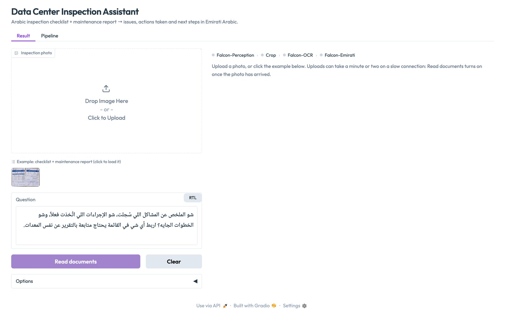
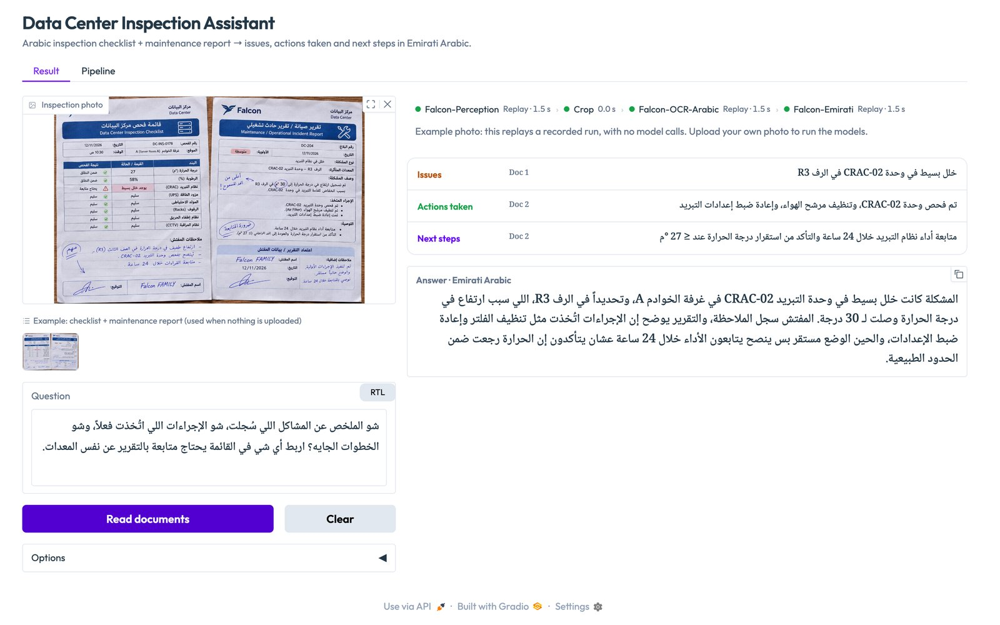
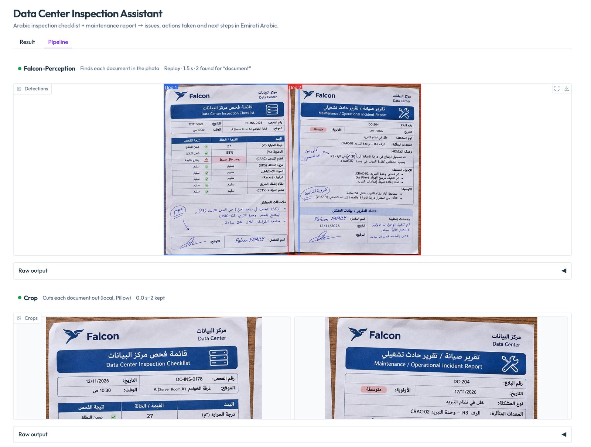
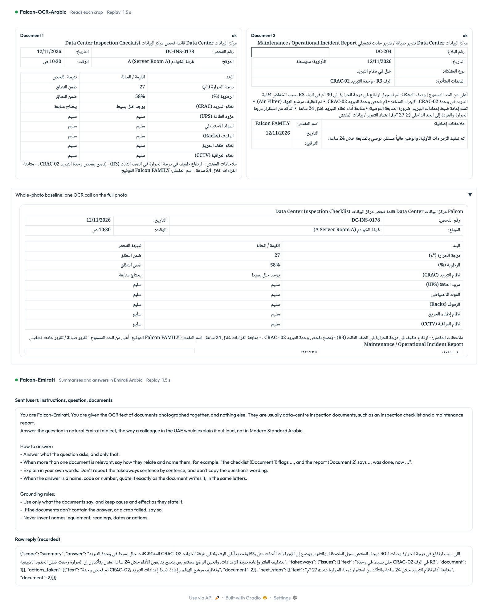

<style>
.screenshot {
  display: block;
  box-sizing: border-box;
  width: 100%;
  max-width: 100%;
  height: auto;
  object-fit: contain;
  margin: 1.5em auto;
  border-radius: 8px;
  box-shadow: 0 4px 6px rgba(0, 0, 0, 0.1);
}
.caption {
  text-align: center;
  font-size: 0.85em;
  opacity: 0.75;
  margin: -0.8em auto 1.5em;
  max-width: 100%;
}
.post-content table:not(.highlighttable, .highlight table, .gist .highlight) {
  display: table;
  width: 100% !important;
  border-collapse: separate;
  border-spacing: 0;
  border: 1px solid rgba(0, 0, 0, 0.18);
  border-radius: 8px;
  overflow: hidden;
  font-size: 0.9em;
}
.post-content table:not(.highlighttable, .highlight table, .gist .highlight) th {
  font-size: 1em;
  font-weight: 600;
  text-align: left;
  background: var(--code-bg);
}
.post-content table:not(.highlighttable, .highlight table, .gist .highlight) th,
.post-content table:not(.highlighttable, .highlight table, .gist .highlight) td {
  padding: 10px 14px;
  text-align: left;
  vertical-align: top;
  border-bottom: 1px solid rgba(0, 0, 0, 0.18);
  border-right: 1px solid rgba(0, 0, 0, 0.18);
}
.post-content table:not(.highlighttable, .highlight table, .gist .highlight) th:last-child,
.post-content table:not(.highlighttable, .highlight table, .gist .highlight) td:last-child {
  border-right: 0;
}
.post-content table:not(.highlighttable, .highlight table, .gist .highlight) tbody tr:last-child td {
  border-bottom: 0;
}
.post-content table:not(.highlighttable, .highlight table, .gist .highlight) tbody tr:nth-child(even) td {
  background: rgba(0, 0, 0, 0.02);
}
@media (max-width: 600px) {
  .post-content table:not(.highlighttable, .highlight table, .gist .highlight) {
    display: block;
    overflow-x: auto;
  }
}
.excerpt {
  font-size: 0.85em;
  opacity: 0.85;
  margin: 0.2em 0 0.4em;
}
.excerpt code {
  font-size: 0.95em;
}
</style>

Field inspection photos can contain several documents at once. A checklist may record a fault while a maintenance report describes what a technician did about it. Reading the text is only part of the job: an assistant also needs to keep each finding tied to the sheet that supports it.

This tutorial follows one such photo through an Arabic document assistant. We look at why the app separates the sheets before OCR and how it turns their contents into an action list.

## The inspection photo

In the example photo, an inspection checklist marks the cooling system as needing follow-up. A maintenance report beside it says a technician checked CRAC-02, cleaned its air filter and reset the cooling settings. The useful output is an action list: which issue was recorded, what was done, and what still needs checking. It also needs to say which sheet supports each item.

We build a Gradio app to get that answer from the photo. Falcon-Perception finds the two documents, Pillow crops them, Falcon-OCR-Arabic reads each crop, and Falcon-Emirati writes the answer in Emirati Arabic. The app labels each takeaway with its source document.





<p class="caption">The app before a run. Click the example to load the sample photo, then press <strong>Read documents</strong>.</p>


<p class="caption">The recorded run cites the checklist for the issue and the report for the actions and next steps.</p>

You need Python and a terminal to run the app locally, but no GPU. Falcon-Perception and Falcon-OCR use a public gateway without a key. Falcon-OCR-Arabic and Falcon-Emirati need private endpoints. The default example replays a recorded run without calling any model endpoints, so it works without private endpoint keys.

## Why separate the documents?

The whole-photo OCR reads the checklist and report as one text stream. The cropped reads keep them separate: Document 1 contains the checklist's cooling status and follow-up note, while Document 2 contains the maintenance actions and recommendation. The app keeps the whole-photo read in the Pipeline tab as a baseline and sends the two labeled crop texts to Falcon-Emirati.

Separating the sheets gives the model a source label for each text block. It can use those labels in the answer and takeaways, so the reader can move from a summary item to the document behind it.

## From photo to answer

The app runs four steps:

1. **[Falcon-Perception](https://huggingface.co/tiiuae/Falcon-Perception)** (0.6B) takes the photo and the query `document`, and returns a box and a mask for each document it finds.
2. **Crop** runs in the Gradio app with Pillow. It filters the boxes and saves one image per document.
3. **[Falcon-OCR-Arabic](https://huggingface.co/blog/tiiuae/falcon-ocr-arabic)** (270M) reads each crop, and the whole photo as a baseline. Without its URL and key, or once its request limit is reached, **[Falcon-OCR](https://huggingface.co/tiiuae/Falcon-OCR)** (270M) on the public gateway reads instead.
4. **[Falcon-Emirati](https://huggingface.co/blog/tiiuae/falcon-emirati)** (7B) receives the OCR texts and the question, and returns an answer plus the takeaways, each citing its document. It never sees the photo.


<p class="caption">What each step hands to the next, and where it runs.</p>

The boundary between steps is simple: Perception returns locations, cropping writes image files, and OCR returns text. When Arabic OCR is unconfigured or its quota is exhausted, the app can use Falcon-OCR without changing detection or the answer step.

The **Result** tab shows the answer and takeaways. The **Pipeline** tab shows the detections, crops, OCR text and model reply behind them.

## Run the example

The [Space](https://huggingface.co/spaces/tiiuae/data-center-inspection-assistant) runs the app with the private models configured. Its **Files** tab contains the code, and you can clone the Space to run it locally. You'll need Python 3.12 and [uv](https://docs.astral.sh/uv/):

```bash
git clone https://huggingface.co/spaces/tiiuae/data-center-inspection-assistant
cd data-center-inspection-assistant
uv sync
uv run python app.py
```

If the example photo is stored with Git LFS/Xet in the Space, install [git-lfs](https://git-lfs.com) before cloning. Without it, the cloned `assets/sample-inspection.png` may be a pointer file, and replay will fail because the app checks the image's exact bytes.

Open `http://127.0.0.1:7860`, click the example under the input to load `assets/sample-inspection.png`, and press **Read documents**. The app replays the outputs in `assets/sample-inspection.recording.json`. It makes no model calls. Replay requires the default question too, because the saved answer responds to that question. A different photo or question runs the models instead.

An uploaded photo goes to TII's public vision gateway and, when configured, the Falcon-OCR-Arabic endpoint. Falcon-Emirati receives the extracted text, not the photo. Use test documents while trying the live path.

### Model access

Falcon-Perception and Falcon-OCR need no key on the public gateway. The Arabic OCR and Emirati models each need a private endpoint URL and a key sent as `Authorization: Bearer`:

| Model | Variables | Without them |
| --- | --- | --- |
| Falcon-OCR-Arabic | `FALCON_ARABIC_OCR_URL`, `FALCON_ARABIC_OCR_API_KEY` | Falcon-OCR on the gateway reads the crops |
| Falcon-Emirati | `FALCON_LLM_URL`, `FALCON_LLM_API_KEY` | The answer quotes the OCR text, with a `Not configured` badge |

Request access through the [TII contact form](https://www.tii.ae/contact-us), naming the model you need. The [Falcon-OCR-Arabic playground](https://ocr.arabic.aidrc.tii.ae/) and [Falcon Chat](https://chat.falconllm.tii.ae/?model=Falcon-Emirati-7B) let you try the models before you have keys. There is also a [Falcon Discord](https://discord.gg/Cbek57PrZE) for questions.

For a local live run, put the endpoint values in a `.env` file next to `app.py` (gitignored and loaded at startup), or export them in your shell:

```bash
FALCON_ARABIC_OCR_URL=https://<host>/v1/ocr
FALCON_ARABIC_OCR_API_KEY=<key>
FALCON_LLM_URL=https://<host>/v1
FALCON_LLM_API_KEY=<key>
```

The remaining settings have defaults:

| Name | Default | What it does |
| --- | --- | --- |
| `FALCON_PERCEPTION_URL`, `FALCON_OCR_URL` | public gateway | Vision gateway URL |
| `FALCON_LLM_MODEL` | `falcon-h1-7b-emirati` | Falcon-Emirati model id (Falcon-Emirati-7B) |
| `PERCEPTION_TASK` | `segment` | `segment` (boxes and masks) or `detect` (boxes only) |
| `OCR_TASK` | `ocr_plain` | `ocr_plain` or `ocr_layout`, for Falcon-OCR only |
| `APP_PASSWORD` | unset | Turns on a login with the user `demo` |
| `MAX_IMAGE_MB`, `MAX_CROPS`, `QUEUE_CONCURRENCY` | `10`, `8`, `4` | Upload size, documents per photo, concurrent runs |
| `FALCON_LLM_TIMEOUT_S`, `FALCON_ARABIC_OCR_TIMEOUT_S`, `VISION_TIMEOUT_S` | `120`, `320`, `600` | Request timeouts in seconds |

After a restart, the Result tab shows which models are live. Falcon-Emirati stays `Not configured` until both its URL and key are set.

### Files

```text
data-center-inspection-assistant/
  app.py                 Gradio UI: the Result and Pipeline tabs
  pipeline.py            runs the four steps and records each one's status and output
  crop.py                cuts each detected document out of the photo
  config.py              environment variables and defaults
  record_example.py      records the example photo's run
  ui_helpers.py          theme, CSS and HTML rendering
  services/
    vision.py            client for the public vision gateway
    perception.py        Falcon-Perception
    ocr.py               Falcon-OCR-Arabic, with Falcon-OCR as the fallback
    llm.py               Falcon-Emirati
    fixtures.py          replay of the example photo
  assets/
    sample-inspection.png
    sample-inspection.recording.json
```

## Talk to the vision gateway

Falcon-Perception and the fallback Falcon-OCR use the same public gateway. A task cannot start with an image file alone: the client uploads it first, then sends the gateway's image ID with the task request.

<p class="excerpt"><strong>Excerpt</strong> from <a href="https://huggingface.co/spaces/tiiuae/data-center-inspection-assistant/blob/main/services/vision.py"><code>services/vision.py</code></a>: <code>Gateway.run</code></p>

```python
def run(self, image_path: str, task: str, query: str) -> dict:
    path_name = TASK_TO_PATH.get((task or "").strip().lower())
    # ...
    image_id = self._ensure_uploaded(path, force=False)
    response = self._post_task(path_name, image_id, query)
    if response.status_code == 404:
        image_id = self._ensure_uploaded(path, force=True)
        response = self._post_task(path_name, image_id, query)
    _raise_for_status(response)
    return _json_body(response)
```

`Gateway` keeps the image ID returned by the upload and checks whether the same image is already available before uploading it again. If the gateway no longer has the image, the client uploads it again and retries the task once.

## Find the documents with Falcon-Perception

Before detection, `prepare_image` applies EXIF orientation and saves a working JPEG. Phone photos can store rotation in metadata while leaving the pixels sideways; using the upright image keeps the returned boxes aligned with the pixels we later crop.

<p class="excerpt"><strong>Excerpt</strong> from <a href="https://huggingface.co/spaces/tiiuae/data-center-inspection-assistant/blob/main/crop.py"><code>crop.py</code></a>: <code>prepare_image</code></p>

```python
def prepare_image(image_path: str, dest: Path) -> str:
    """Apply EXIF orientation and write a working JPEG."""
    with Image.open(image_path) as image:
        oriented = ImageOps.exif_transpose(image).convert("RGB")
        dest.parent.mkdir(parents=True, exist_ok=True)
        oriented.save(dest, format="JPEG", quality=92)
    return str(dest)
```

The upright photo and query `document` then go to `/segment`. Its boxes use `[x1, y1, x2, y2]` coordinates in the gateway's image size. We scale them to the working photo and store normalized centers and sizes. In `segment` mode, each detection also includes a mask for isolating overlapping sheets.

<p class="excerpt"><strong>Excerpt</strong> from <a href="https://huggingface.co/spaces/tiiuae/data-center-inspection-assistant/blob/main/services/perception.py"><code>services/perception.py</code></a>: <code>_localise_live</code> (abridged)</p>

```python
with vision.Gateway(cfg) as gateway:
    payload = gateway.run(image_path, config.PERCEPTION_TASK, query)

src_w = int(payload.get("image_width") or local_w) or local_w
src_h = int(payload.get("image_height") or local_h) or local_h
scale_x = local_w / src_w if src_w else 1.0
scale_y = local_h / src_h if src_h else 1.0

for item in payload.get("masks") or []:
    # ...
    detections.append(
        Detection(
            center=[((x1 + x2) / 2) / local_w, ((y1 + y2) / 2) / local_h],
            size=[(x2 - x1) / local_w, (y2 - y1) / local_h],
            score=_score(item),
            mask=mask,
        )
    )
```

These gateway detections have no confidence value, so `_score` uses `1.0`. On the example, Perception finds the checklist and report:


<p class="caption">The top of the Pipeline tab: two detections, then the two crops sent to OCR.</p>

## Crop each document

OCR needs an image for each detected sheet. `crop_documents` first drops boxes occupying less than 1% of the photo. In the default mode, it also drops a box when its intersection over union (IoU) with one already kept is at least 0.7. Because the gateway gives these boxes the same score, the one listed first wins that tie.

The kept boxes are ordered from top to bottom, then left to right, and capped at eight. That bounds the number of crop OCR requests. Each box gets 4% padding to keep the document edges in the saved JPEG.

<p class="excerpt"><strong>Excerpt</strong> from <a href="https://huggingface.co/spaces/tiiuae/data-center-inspection-assistant/blob/main/crop.py"><code>crop.py</code></a>: <code>crop_documents</code> (abridged)</p>

```python
for order, item in enumerate(candidates["kept"], start=1):
    box = item["box"]
    mask = item["detection"].mask
    use_seg = segmentation_only and bool(mask) and any(any(r) for r in mask)
    # ...
    padded = _pad_box(box, width, height)
    # ...
    piece = image.crop(tuple(padded))
    if use_seg:
        piece = _isolate_with_mask(
            piece, padded, item["box"], mask, width, height
        )
    piece.save(path, format="JPEG", quality=92)
```

The example sheets sit side by side, so rectangular crops work. For sheets that overlap, **Segmentation mode** uses each instance mask and whitens pixels outside it. That keeps text from the top sheet out of the crop for the sheet underneath, where a rectangle alone would include both.

## Read each crop with Falcon-OCR-Arabic

OCR reads every crop and the full photo. The full-photo text stays in the Pipeline tab as a baseline; only the crop texts go to Falcon-Emirati. Requests run in parallel with up to four workers.

With `FALCON_ARABIC_OCR_URL` and `FALCON_ARABIC_OCR_API_KEY` set, **Enhance Arabic** starts on and sends the images to Falcon-OCR-Arabic. Without both values, the option is disabled and Falcon-OCR on the public gateway does the reading.

The Result tab identifies the reader used for the run. Both invite-only endpoints have a per-minute and a daily limit per key, and a run uses one Falcon-OCR-Arabic request per document plus one for the whole photo. When a limit is hit, the endpoint answers 429 with the limit's name and a `Retry-After`. The app then reads the photo with Falcon-OCR and says which limit was hit and when it resets.


<p class="caption">The bottom of the Pipeline tab: each document's OCR text, the whole-photo baseline, then what Falcon-Emirati received and returned.</p>

## Ask Falcon-Emirati

Falcon-Emirati sees the question and one labelled text block per crop, never the photo.

The default question carries the inspection task. The instructions tell Falcon-Emirati to answer only that question, use the supplied OCR text, write in Emirati Arabic and return JSON. The `scope` field distinguishes a `summary` from a single `fact`: fact answers leave the takeaway lists empty, while summary takeaways cite the document that supports each item.

<p class="excerpt"><strong>Excerpt</strong> from <a href="https://huggingface.co/spaces/tiiuae/data-center-inspection-assistant/blob/main/services/llm.py"><code>services/llm.py</code></a>: <code>INSTRUCTIONS</code></p>

```text
You are Falcon-Emirati. You are given the OCR text of documents photographed together, and nothing else. They are usually data-centre inspection documents, such as an inspection checklist and a maintenance report.
Answer the question in natural Emirati dialect, the way a colleague in the UAE would explain it out loud, not in Modern Standard Arabic.

How to answer:
- Answer what the question asks, and only that.
- When more than one document is relevant, say how they relate and name them, for example: "the checklist (Document 1) flags ..., and the report (Document 2) says ... was done; now ...".
- Explain in your own words. Don't repeat the takeaways sentence by sentence, and don't copy the question's wording.
- When the answer is a name, code or number, quote it exactly as the document writes it, in the same letters.

Grounding rules:
- Use only what the documents say, and keep cause and effect as they state it.
- If the documents don't contain the answer, or a crop failed, say so.
- Never invent names, equipment, readings, dates or actions.

Return one JSON object and no other text:
{"scope": "summary", "answer": "<Emirati Arabic answer to the question>", "takeaways": {"issues": [{"text": "<short, Emirati Arabic>", "document": 1}], "actions_taken": [{"text": "...", "document": 2}], "next_steps": [{"text": "...", "document": 2}]}}
- "scope" comes first. It is "summary" when the question asks about issues, actions taken or next steps, and "fact" when it asks for one piece of information (a name, a date, a reading).
- When scope is "fact", all three takeaway lists are empty.
- When scope is "summary", each takeaway cites the one document its text comes from. Leave a list empty when the documents say nothing for it.
```

The default question asks for the inspection summary and a link between the checklist and report:

<p class="excerpt"><strong>Excerpt</strong> from <a href="https://huggingface.co/spaces/tiiuae/data-center-inspection-assistant/blob/main/services/llm.py"><code>services/llm.py</code></a>: <code>DEFAULT_QUESTION</code></p>

```python
DEFAULT_QUESTION = (
    "شو الملخص عن المشاكل اللي سُجلت، شو الإجراءات اللي اتُخذت فعلاً، وشو الخطوات الجايه؟ "
    "اربط أي شي في القائمة يحتاج متابعة بالتقرير عن نفس المعدات."
)
```

In English, it asks what issues were recorded, what was actually done, and what should happen next. It also asks the model to link checklist items needing follow-up to the report about the same equipment.

The question box is editable. With the default question, the recorded example shows a summary and takeaways; the instructions also cover single-fact questions.

The recorded answer to the default question is:

<blockquote dir="rtl" lang="ar">
<p>المشكلة كانت خلل بسيط في وحدة التبريد CRAC-02 في غرفة الخوادم A، وتحديداً في الرف R3، اللي سبب ارتفاع في درجة الحرارة وصلت لـ 30 درجة. المفتش سجل الملاحظة، والتقرير يوضح إن الإجراءات اتُخذت مثل تنظيف الفلتر وإعادة ضبط الإعدادات، والحين الوضع مستقر بس ينصح يتابعون الأداء خلال 24 ساعة عشان يتأكدون إن الحرارة رجعت ضمن الحدود الطبيعية.</p>
</blockquote>

In English, the recorded answer says the problem was a minor fault in cooling unit CRAC-02 in server room A, specifically at rack R3, which caused the temperature to rise to 30 degrees. The inspector recorded the note, and the report shows the actions were taken, such as cleaning the filter and resetting the settings. The situation is stable now, but it's advised to monitor performance for 24 hours to make sure the temperature is back within normal limits.

Without `FALCON_LLM_URL` and `FALCON_LLM_API_KEY`, the step calls no model. It displays the OCR text under a `Not configured` notice and produces no takeaways.

## Keep the run inspectable

`run_pipeline` connects the four steps and yields a trace after each state change. The UI can show progress as it happens, and the Pipeline tab shows each step's model, timing and output. Endpoint keys are excluded from the trace.

The example is reproducible without private keys because its outputs were recorded from model calls. `record_example.py` saves the detections, each document's OCR text and the Falcon-Emirati reply. Replay matches the photo by its bytes and the question by its text. A different photo or question uses the live models. To refresh the recording after changing the example, run the script with the private endpoints configured:

```bash
uv run python record_example.py
```

## Show the result and the evidence

The **Result** tab keeps the input photo and example, question, one-line model status, takeaways and answer together. The question starts right to left with the default Emirati Arabic prompt; **Read documents** and **Clear** sit below it. **Options** holds the Perception query, **Enhance Arabic** and **Segmentation mode**. The **Pipeline** tab exposes the step outputs, with raw JSON in collapsed sections and the whole-photo OCR baseline in its own section.

**Read documents** stays off until a photo has arrived and the question isn't empty, so a run can't start while an upload is still in progress. `on_run` redraws the UI from each trace snapshot, and disables **Read documents** and **Clear** until the answer is ready.

## See the recorded result

The recorded example finds two documents and reads them separately. The Result tab shows an answer in Emirati Arabic and three takeaway categories: an issue citing Doc 1, actions taken citing Doc 2, and next steps citing Doc 2. The Pipeline tab shows the detected sheets, their crops and OCR text, the whole-photo baseline and the model reply.

Try the [Space](https://huggingface.co/spaces/tiiuae/data-center-inspection-assistant) with a test inspection photo, or clone it and run locally to follow the same steps with your own documents.

## References

- [Data Center Inspection Assistant Space](https://huggingface.co/spaces/tiiuae/data-center-inspection-assistant): the app and its code.
- [Falcon-Perception](https://huggingface.co/tiiuae/Falcon-Perception): model card and weights.
- [Falcon-OCR](https://huggingface.co/tiiuae/Falcon-OCR): model card and weights. The fallback reader on the public vision gateway.
- [Falcon-OCR-Arabic](https://huggingface.co/blog/tiiuae/falcon-ocr-arabic): announcement post. The default reader when its endpoint is configured.
- [Falcon-Emirati](https://huggingface.co/blog/tiiuae/falcon-emirati) and its [model page](https://falconllm.tii.ae/falcon-emirati.html).
- [Falcon vision gateway](https://vision.falcon.aidrc.tii.ae): the public endpoint behind `/segment`, `/detect`, `/ocr_plain` and `/ocr_layout`.
- [TII contact form](https://www.tii.ae/contact-us), to request Falcon-OCR-Arabic and Falcon-Emirati access.
- [Gradio docs](https://www.gradio.app/docs), [uv](https://docs.astral.sh/uv/) and [Pillow](https://pillow.readthedocs.io/).
